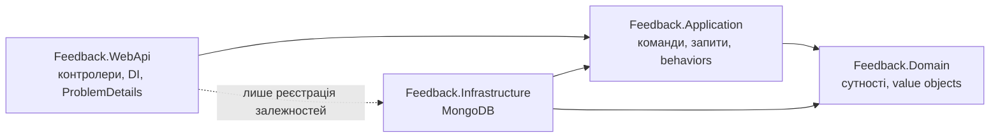
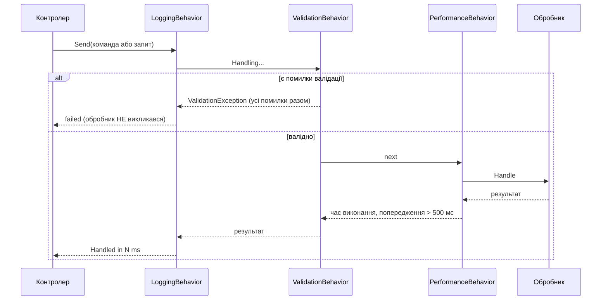

# Wearcast: платформа підбору одягу за погодою

Платформа складається з мікросервісів, кожен із власною базою даних. Користувач складає **власний гардероб**, система щодня сама отримує прогноз погоди за містом з профілю й підбирає образи **лише з тих речей, що підходять під погоду**. Після носіння користувач залишає відгук («замерз / комфортно / жарко»).

| Сервіс | Лаб. | Архітектура й технології | База даних | Документація |
|---|---|---|---|---|
| **Recommendations** | 02 | три шари, ADO.NET + Dapper | SQL Server `OutfitRecommendationsDb` | [docs/recommendations-service.md](docs/recommendations-service.md) |
| **Wardrobe** | 03 | три шари, EF Core (Code First), специфікації | SQL Server `WardrobeEfDb` | [docs/wardrobe-service.md](docs/wardrobe-service.md) |
| **Feedback** | **04** | **Clean Architecture + CQRS (MediatR)** | **MongoDB `outfitFeedbackDb`** | **цей документ** |

Дані між сервісами не діляться: немає спільних таблиць і зовнішніх ключів між базами, посилання лише за ідентифікатором. Проєктування баз і контекстів: [docs/lab01-report.md](docs/lab01-report.md).

## Зміст

1. [Структура репозиторію](#структура-репозиторію)
2. [Що потрібно для запуску](#що-потрібно-для-запуску)
3. [Запуск через Aspire](#запуск-через-aspire)
4. [Сервіс «Відгуки»: Clean Architecture](#сервіс-відгуки-clean-architecture)
5. [Domain](#domain)
6. [Application: CQRS і Pipeline Behaviors](#application-cqrs-і-pipeline-behaviors)
7. [Infrastructure: MongoDB](#infrastructure-mongodb)
8. [WebApi](#webapi)
9. [Обробка помилок](#обробка-помилок)
10. [Оптимістична конкурентність](#оптимістична-конкурентність)
11. [Логування](#логування)
12. [Тести](#тести)
13. [Політика дублювання даних](#політика-дублювання-даних)
14. [Перевірка роботи](#перевірка-роботи)
15. [Робота з Git](#робота-з-git)

---

## Структура репозиторію

```text
.
├── README.md
├── Platform.slnx                       одне рішення на всю платформу
├── Platform.AppHost/                   оркестрація .NET Aspire (AppHost.cs)
├── Services/
│   ├── Recommendations/                Лаб. 02 (Api, Bll, Dal, Domain)
│   ├── Wardrobe/                       Лаб. 03 (Api, Bll, Dal, Domain)
│   └── Feedback/                       Лаб. 04: Clean Architecture + CQRS + MongoDB
│       ├── Feedback.Domain/            сутності, value objects, інтерфейси
│       ├── Feedback.Application/       команди, запити, behaviors, валідатори
│       ├── Feedback.Infrastructure/    Mongo-контекст, BSON-мапінг, репозиторії, індекси, сідінг
│       ├── Feedback.WebApi/            контролер, Program.cs, обробка помилок
│       └── Feedback.Tests/             unit-тести
├── db/
│   ├── p1/                             SQL Server (Recommendations)
│   ├── p2/                             SQL Server (Лаб. 01) та EF-скрипт ef-initial.sql
│   └── p3/                             MongoDB (Лаб. 01): collections.js, seed.js, queries.js
└── docs/                               ERD, карта контекстів, описи сервісів
```

## Що потрібно для запуску

- **.NET SDK 9 або 10** (`dotnet --version`)
- **Docker Desktop** (запущений) для запуску через Aspire
- Для окремого запуску сервісу «Відгуки»: MongoDB на `localhost:27017` (наприклад, локальна або `docker run -d -p 27017:27017 mongo:7`)
- За бажанням: MongoDB Compass для перегляду документів

## Запуск через Aspire

Одна команда піднімає SQL Server, MongoDB і всі три сервіси:

```bash
dotnet run --project Platform.AppHost
```

1. У консолі з'явиться посилання на **Aspire Dashboard** (`https://localhost:17xxx/login?t=...`).
2. Ресурси `sql`, `RecommendationsDb`, `WardrobeDb`, `mongo`, `FeedbackDb`, `recommendations-api`, `wardrobe-api` і `feedback-api` мають перейти в статус **Running**.
3. У колонці **Endpoints** рядка `feedback-api` клікни адресу й допиши `/swagger`.

Ім'я ресурсу бази в `AppHost.cs` (`FeedbackDb`) збігається з іменем рядка підключення, яке читає сервіс (`ConnectionStrings:FeedbackDb`), тому Aspire передає його змінною оточення, а код сервісу змінювати не треба. Індекси та початкові дані сервіс «Відгуки» створює **сам** під час старту.

**Compass.** MongoDB у контейнері відкрита на фіксованому порту **27018**. Пароль адміністратора: Dashboard → ресурс `mongo` → змінна `MONGO_INITDB_ROOT_PASSWORD`. Рядок підключення:

```text
mongodb://admin:<пароль>@localhost:27018/?authSource=admin
```

### Окремий запуск сервісу «Відгуки»

1. Переконайся, що MongoDB працює на `localhost:27017`.
2. За потреби зміни секцію `MongoDb` у `Services/Feedback/Feedback.WebApi/appsettings.json`:

   ```json
   "MongoDb": {
     "ConnectionString": "mongodb://localhost:27017/?maxPoolSize=50&serverSelectionTimeoutMS=5000",
     "DatabaseName": "outfitFeedbackDb",
     "InitializeOnStartup": true
   }
   ```

   Окремі значення для середовищ задаються файлами `appsettings.{Environment}.json` або змінними оточення (`MongoDb__ConnectionString`). Параметри пулу з'єднань і таймаутів вказуються в рядку підключення (`maxPoolSize`, `serverSelectionTimeoutMS`).
3. Запуск:

   ```bash
   dotnet run --project Services/Feedback/Feedback.WebApi --launch-profile http
   ```

   Адреса видно в консолі (`Now listening on: ...`), Swagger: `/swagger`.

---

## Сервіс «Відгуки»: Clean Architecture

Чотири шари. **Внутрішні шари не знають про зовнішні**; Infrastructure лише реалізує інтерфейси, оголошені у внутрішніх шарах.



| Шар | Залежить від | Зміст |
|---|---|---|
| `Feedback.Domain` | **нічого** (лише типи BSON `ObjectId` з пакета `MongoDB.Bson`, без драйвера БД) | `BaseEntity`, `ValueObject`, сутності, value objects, доменні винятки, інтерфейси репозиторіїв |
| `Feedback.Application` | Domain | сценарії використання: команди й запити MediatR, обробники, валідатори FluentValidation, Pipeline Behaviors, інтерфейс читання `IFeedbackQueries` |
| `Feedback.Infrastructure` | Application, Domain | `MongoDbContext`, BSON-мапінг, репозиторії, запити читання, індекси, сідінг |
| `Feedback.WebApi` | Application, Infrastructure (лише для DI) | контролер, AutoMapper, обробка помилок, Serilog, Swagger, `Program.cs` |

Кожен шар надає власний метод розширення DI (`AddApplication`, `AddInfrastructure`), які викликає `Program.cs`. Перевірка: у `Feedback.Domain.csproj` немає посилань на інші проєкти.

## Domain

- **`BaseEntity` для MongoDB:** `Id` (`ObjectId`), `CreatedAt`, `UpdatedAt`, `Version` (оптимістична конкурентність).
- **`ValueObject`:** порівняння **за значеннями** компонентів (`Equals`, `GetHashCode`, `==`). Value Objects незмінні, без setter-ів, з валідацією в конструкторі:

  | Value Object | Призначення |
  |---|---|
  | `Author` | вкладений документ `author` (`userId`, `displayName`) |
  | `ItemSnapshot` | знімок речі з образу на момент відгуку (денормалізація) |
  | `TemperatureNote` | відчута й прогнозована температура (є не в усіх документах) |
  | `Comment` | вкладений коментар |

- **Сутності:** `OutfitFeedback` (корінь агрегату відгуку) і `Discussion` (тема обговорення; повідомлення зберігаються окремо за посиланням).
- **Інкапсуляція:** приватні setter-и, зміни лише методами (`Update`, `AddComment`, `AddPhoto`, `AttachDiscussion`), інваріанти перевіряються в конструкторі й методах, порушення дають `DomainException` ще до звернення до БД: оцінка 1–5, текст до 2000 символів, **не більше 5 вкладених коментарів** (довше обговорення живе в окремій колекції), не більше 10 фото, не більше 20 речей у знімку.
- **Інтерфейси:** `IFeedbackRepository` і `IDiscussionRepository` оголошені в Domain, реалізовані в Infrastructure.

## Application: CQRS і Pipeline Behaviors

Операції **запису** (Commands) і **читання** (Queries) розділені: кожна має окремий об'єкт-запит з окремим обробником.

| Тип | Операція | Об'єкт |
|---|---|---|
| Command | створити відгук | `CreateFeedbackCommand` → `ObjectId` рядком |
| Command | змінити відгук | `UpdateFeedbackCommand` (з `ExpectedVersion`) → нова версія |
| Command | видалити відгук | `DeleteFeedbackCommand` |
| Command | додати коментар | `AddCommentCommand` → нова версія |
| Query | відгук за Id | `GetFeedbackByIdQuery` → `FeedbackDetailsDto` |
| Query | список | `GetFeedbackListQuery` (фільтри, пошук, пагінація) → `PagedResult<FeedbackDto>` |

Обробники запитів не звертаються до MongoDB: вони викликають інтерфейс **`IFeedbackQueries`** (Application), реалізований в Infrastructure. Контролер і обробники не використовують `IMongoCollection` напряму.

### Pipeline Behaviors

Кожна команда й кожен запит проходять через ланцюжок «обгорток» перед обробником. Порядок реєстрації (`AddOpenBehavior`) визначає порядок виконання: перший зареєстрований стає найзовнішнім.



| Behavior | Призначення |
|---|---|
| `LoggingBehavior` | структуроване логування кожного запиту: що прийшло, скільки тривало, чим закінчилось |
| `ValidationBehavior` | виконує всі валідатори FluentValidation, збирає **всі** помилки й кидає `ValidationException`; обробник при цьому **не викликається** |
| `PerformanceBehavior` | вимірює час обробника (разом із запитами до MongoDB), попереджає, якщо довше 500 мс |

**Валідатори** (`AbstractValidator<T>`) є для всіх команд і запитів і реєструються автоматично (`AddValidatorsFromAssembly`). MongoDB-специфічні правила: коректність рядка `ObjectId` (`ObjectId.TryParse`), допустимі значення `feeling`. **Асинхронна валідація із запитом до MongoDB:** користувач не може залишити другий відгук на той самий образ.

## Infrastructure: MongoDB

- **`MongoDbContext`** отримує налаштування через `IOptions<MongoDbOptions>` (рядок підключення, назва БД) і надає колекції `outfitFeedback` та `discussions`. Реєструється як Singleton (`MongoClient` потокобезпечний).
- **BSON-серіалізація (`BsonClassMap`)** налаштована в `MongoMappings` **без атрибутів у доменних класах**: єдина конвенція імен (camelCase, як у Лаб. 01), enum рядком, приватні поля колекцій під іменами `comments`, `photos`, `itemSnapshot`, незмінні Value Objects створюються через конструктор (`MapCreator`), невідомі поля ігноруються (гнучка схема). Мапінг реєструється один раз при старті, до першого звернення до БД.
- **`FeedbackRepository`** (шлях запису) реалізує `IFeedbackRepository` через MongoDB Driver; **`FeedbackQueries`** (шлях читання) будує список **aggregation pipeline**: `$match` (фільтри, `$text`), `$sort`, `$skip`, `$limit`, `$project` із підрахунком коментарів (`$size`). Пагінація й фільтрація виконуються засобами MongoDB, у пам'ять потрапляє лише сторінка, а з документів вибираються лише потрібні поля.

### Індекси (створюються автоматично при старті)

`IndexCreationService` (`IHostedService`) визначає індекси в коді. Повторне створення наявного індексу безпечне. Назви збігаються з Лаб. 01.

| Індекс | Призначення |
|---|---|
| `ux_feedback_outfit_user` (унікальний: `outfitId`, `author.userId`) | один відгук від автора на образ |
| `ix_feedback_user_date` (`author.userId`, `createdAt` -1) | відгуки користувача, найновіші першими |
| `ix_feedback_user_feeling` (`author.userId`, `feeling`, `createdAt` -1) | розподіл відчуттів |
| `ix_feedback_outfit_date` (`outfitId`, `createdAt` -1) | складений: останні відгуки про образ |
| `ix_feedback_with_photos` (частковий: `photos` існує) | стрічка відгуків із фото |
| `tx_feedback_text` (текстовий) | повнотекстовий пошук (`?search=`) |
| `ix_discussions_last` (колекція `discussions`) | стрічка обговорень за активністю |

Перевірка в Compass або `mongosh`: `db.outfitFeedback.getIndexes()` показує всі індекси, а не лише `_id`.

### Сідінг

`IDataSeeder` і `FeedbackSeeder` наповнюють базу початковими даними: повний відгук із вкладеними масивами (`itemSnapshot`, `photos`, `comments`) і обговоренням, короткий із `temperatureNote` та два мінімальні (різні набори полів, гнучка схема). Сідінг **ідемпотентний**: якщо колекція вже наповнена, нічого не робить; використовує `InsertManyAsync`. Вимикається налаштуванням `MongoDb:InitializeOnStartup = false`.

Приклад документа в колекції `outfitFeedback`:

```json
{
  "_id": { "$oid": "..." },
  "createdAt": { "$date": "..." },
  "version": 0,
  "outfitId": 1,
  "author": { "userId": 1, "displayName": "Олена" },
  "feeling": "Comfortable",
  "rating": 5,
  "text": "Вітровка і светр виручили...",
  "photos": [ "fb1_a.jpg", "fb1_b.jpg" ],
  "itemSnapshot": [ { "itemId": 2, "name": "Легка вітровка", "slot": "Top" } ],
  "comments": [ { "author": "Андрій", "text": "Класний образ", "createdAt": { "$date": "..." } } ],
  "discussionId": { "$oid": "..." }
}
```

У документі немає внутрішніх полів .NET (`_comments`, `Id`, `_t`).

## WebApi

Контролер лише передає команди й запити в MediatR через `ISender` (базовий `ApiControllerBase`). Усі методи асинхронні. Вхідні контракти (`CreateFeedbackRequest`, `UpdateFeedbackRequest`, `AddCommentRequest`) перетворюються на команди **AutoMapper-ом** (`FeedbackProfile`). Swagger: `/swagger`.

| Метод і шлях | Операція MediatR | Успіх | Помилки |
|---|---|---|---|
| `GET /api/feedback` | `GetFeedbackListQuery` | 200 | 400 |
| `GET /api/feedback/{id}` | `GetFeedbackByIdQuery` | 200 + `ETag` | 400, 404 |
| `POST /api/feedback` | `CreateFeedbackCommand` | **201 + `Location`**, у тілі рядковий `ObjectId` | 400, 409 |
| `PUT /api/feedback/{id}` | `UpdateFeedbackCommand` | 200 + `ETag` | 400, 404, **409** |
| `POST /api/feedback/{id}/comments` | `AddCommentCommand` | 200 + `ETag` | 400, 404, 409 |
| `DELETE /api/feedback/{id}` | `DeleteFeedbackCommand` | 204 | 400, 404 |

Параметри списку: `outfitId`, `authorUserId`, `feeling` (`Cold`, `Comfortable`, `Hot`), `search` (повнотекстовий, через text-індекс), `page` (від 1), `pageSize` (1–100, за замовчуванням 20). Відповідь: `items`, `totalCount`, `page`, `pageSize`, `totalPages`, `hasNext`, `hasPrevious`; загальна кількість також у заголовку `X-Total-Count`.

Приклади (`$API` це адреса сервісу):

```bash
# створити відгук: 201 + Location
curl -X POST "$API/api/feedback" -H "Content-Type: application/json" \
  -d '{"outfitId":10,"authorUserId":1,"authorName":"Олена","feeling":"Comfortable","rating":5,"text":"Тепло й зручно"}'

# rating = 10 відхиляється валідацією ДО виклику обробника: 400
curl -X POST "$API/api/feedback" -H "Content-Type: application/json" \
  -d '{"outfitId":11,"authorUserId":1,"authorName":"Олена","feeling":"Hot","rating":10}'

# список із повнотекстовим пошуком
curl "$API/api/feedback?search=светр&page=1&pageSize=5"
```

Готові запити: `Services/Feedback/Feedback.WebApi/Feedback.WebApi.http`.

## Обробка помилок

Усі винятки обробляє **один** глобальний обробник (`IExceptionHandler` + `AddProblemDetails`), включно з MongoDB-специфічними. Відповідь: `ProblemDetails` із `traceId` та `correlationId`.

| Виняток | HTTP-статус |
|---|---|
| `NotFoundException` | **404** |
| `ValidationException` (FluentValidation, усі помилки разом по полях) | **400** |
| `DomainException` (правила сутностей) | **400** |
| `ConflictException` (зокрема конфлікт версій) | **409** |
| `MongoWriteException` з `DuplicateKey` (унікальний індекс) | **409** (інші помилки запису: 400) |
| `MongoConnectionException`, таймаут вибору сервера | **503** |
| будь-який інший | **500** (деталі лише в Development) |

Приклад 400 (`rating = 10`):

```json
{
  "title": "Validation error",
  "status": 400,
  "detail": "One or more validation errors occurred",
  "errors": { "Rating": [ "'Rating' must be between 1 and 5. You entered 10." ] },
  "traceId": "...", "correlationId": "..."
}
```

Повторний відгук того самого користувача на той самий образ відхиляється асинхронним валідатором (**400**), а унікальний індекс `ux_feedback_outfit_user` є другою лінією захисту (**409**). Некоректний `ObjectId` у маршруті дає 400, коректний, але неіснуючий, дає 404.

## Оптимістична конкурентність

Кожен документ має поле `version`. Оновлення виконується лише для документа з очікуваною версією: репозиторій заміняє документ умовою `{ _id, version: <очікувана> }`, а при розбіжності кидає `ConflictException` (409). Документи без поля `version` (старі, з Лаб. 01) вважаються версією 0.

На рівні HTTP це **ETag / If-Match**:

1. `GET /api/feedback/{id}` повертає версію в заголовку `ETag: "0"`.
2. `PUT /api/feedback/{id}` (і додавання коментаря) приймає її в заголовку `If-Match: "0"`.
3. Якщо документ уже змінив хтось інший, відповідь **409 Conflict**; успішна зміна повертає нову версію в `ETag`.

Заголовок `If-Match` необов'язковий (без нього перевіряється лише захист від гонки між читанням і записом у репозиторії).

## Логування

Serilog, структуровані логи (sink: консоль). Кожен запис запиту містить властивості `CorrelationId` (заголовок `X-Correlation-Id` або новий) і `RequestPath`. `LoggingBehavior` логує кожну команду й запит. Для запиту, відхиленого валідацією, у логу є рядки `Handling ...` та `Request ... failed ... ValidationException`, а рядків самого обробника (`Handler: ...`) **немає**: це доводить, що обробник не виконувався. У логи не записуються секрети.

## Тести

```bash
dotnet test Services/Feedback/Feedback.Tests
```

Тести виконуються **без запущеної MongoDB**:
- **Domain:** створення відгуку з `Rating = 10` кидає `DomainException`, рівність Value Objects за значенням, обмеження на коментарі;
- **Application:** pipeline відхиляє некоректні команди, обробник при цьому не викликається; усі помилки збираються разом; асинхронний валідатор дублікатів; конфлікт версій;
- **Infrastructure:** BSON-відображення (camelCase, приватні колекції, enum рядком, без внутрішніх полів .NET), повернення документа назад, читання документа у стилі Лаб. 01;
- **WebApi:** конфігурація AutoMapper валідна, команди мапляться з контрактів.

## Політика дублювання даних

Між базами немає зовнішніх ключів. Повна таблиця для всіх баз: [docs/lab01-report.md](docs/lab01-report.md), розділ 8. Для сервісу «Відгуки»:

| Поле | Де зберігається | Власник даних | Політика узгодженості |
|---|---|---|---|
| `outfitId` | `outfitFeedback` | Outfits (Recommendations) | лише посилання за Id, **без FK** |
| `author.userId` | `outfitFeedback`, `discussions` | Users (Recommendations) | лише посилання за Id, без FK |
| `author.displayName` | `outfitFeedback`, `discussions` | Users (Recommendations) | **копія для читання**, оновлюється подією (Лаб. 08) |
| `itemSnapshot[]` (назва й слот речі) | `outfitFeedback` | Wardrobe та Recommendations | **знімок** на момент відгуку, не оновлюється |
| `temperatureNote` | `outfitFeedback` | дані самого відгуку | знімок відчуттів користувача |
| `UserProfiles.ColdSensitivity` | Recommendations | Recommendations | похідне значення: Відгуки лише публікують подію, перерахунок виконує власник |

## Перевірка роботи

| # | Перевірка | Очікуваний результат |
|---|---|---|
| 1 | `dotnet list Services/Feedback/Feedback.Domain reference` | посилань на інші проєкти немає |
| 2 | `POST /api/feedback` з `rating = 10` | **400**; у лозі `LoggingBehavior` обробника немає |
| 3 | `POST /api/feedback` двічі для того самого `outfitId` і `authorUserId` | другий запит відхилено (**400** від валідатора або **409** від унікального індексу) |
| 4 | `PUT /api/feedback/{id}` двічі з `If-Match: "0"` | перший **200**, другий **409** |
| 5 | `GET /api/feedback/000000000000000000000000` | **404** |
| 6 | `GET /api/feedback/not-an-object-id` | **400** |
| 7 | `GET /api/feedback?search=светр` | повнотекстовий пошук повертає відгук |
| 8 | Compass: колекція `outfitFeedback` | camelCase, вкладені `author` і `comments`, без внутрішніх полів .NET |
| 9 | `db.outfitFeedback.getIndexes()` | створені індекси, а не лише `_id` |
| 10 | перезапуск `feedback-api` | сідінг не дублює дані |
| 11 | Aspire Dashboard | усі ресурси у статусі **Running** |
| 12 | `dotnet test Services/Feedback/Feedback.Tests` | усі тести зелені |

## Робота з Git

- Кожна лабораторна розробляється в **окремій гілці** (`lab-01`, `lab-02`, `lab-03`, `lab-04`, ...), що відгалужується від попередньої; `main` містить лише початковий коміт.
- Усередині лаби завдання виконуються в гілках `feature/...` і зливаються в гілку лаби через **Pull Request** з описом змін.

## Примітка про ліцензії MediatR і AutoMapper

MediatR 13+ і AutoMapper 15+ розповсюджуються компанією Lucky Penny Software за комерційною ліцензією з безкоштовною Community-редакцією (навчальне та некомерційне використання); обидва пакети покриває один ключ (`LuckyPenny:LicenseKey` в `appsettings.json`). Без ключа застосунок працює, але записує в лог повідомлення про відсутність ліцензії.
