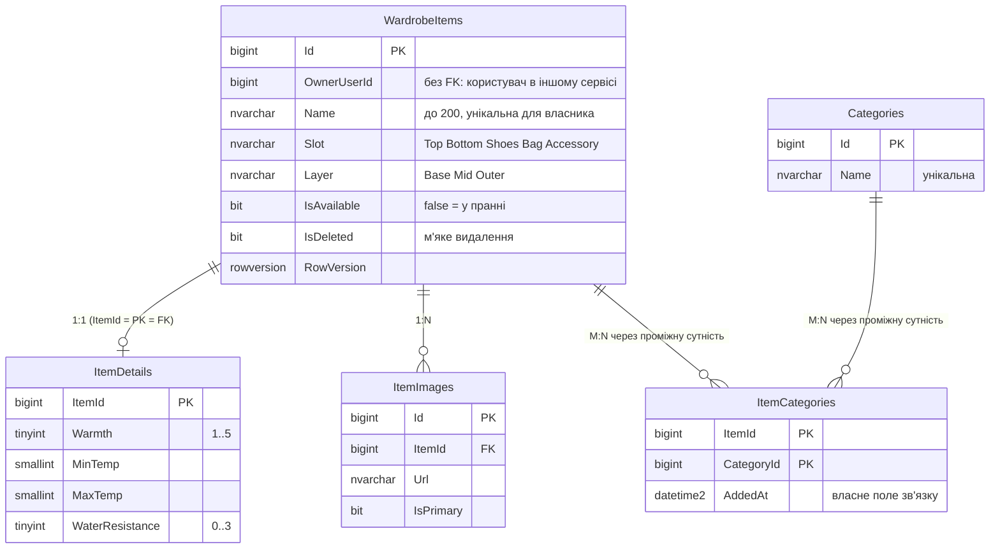

# Wearcast: платформа підбору одягу за погодою

Платформа складається з мікросервісів, кожен із власною базою даних. Користувач складає **власний гардероб**, а система щодня сама отримує прогноз погоди за містом з профілю й підбирає образи **лише з тих речей, що підходять під погоду** (у сніг без шортів і кросівок, у дощ лише водостійке, речі в пранні й вимкнені слоти пропускаються).

| Сервіс | Лабораторна | Технологія | База даних | Опис |
|---|---|---|---|---|
| **Recommendations** | Лаб. 02 | ADO.NET + Dapper | `OutfitRecommendationsDb` | профілі, погода, образи, статуси образу; [детальний опис](docs/recommendations-service.md) |
| **Wardrobe** | **Лаб. 03** | **EF Core (Code First)** | `WardrobeEfDb` | речі гардероба, деталі, фото, категорії; міграції, пагінація, специфікації |

Дані між сервісами не діляться: немає спільних таблиць і зовнішніх ключів між базами; посилання лише за ідентифікатором (`OwnerUserId`), а потрібні копії полів описані в [політиці дублювання](#політика-дублювання-даних).

Опис проєктування баз і контекстів: [`docs/lab01-report.md`](docs/lab01-report.md).

## Зміст

1. [Структура репозиторію](#структура-репозиторію)
2. [Що потрібно для запуску](#що-потрібно-для-запуску)
3. [Запуск через Aspire](#запуск-через-aspire)
4. [Запуск сервісу «Гардероб» окремо](#запуск-сервісу-гардероб-окремо)
5. [Модель даних і міграції](#модель-даних-і-міграції)
6. [Сідінг](#сідінг)
7. [Архітектура сервісу «Гардероб»](#архітектура-сервісу-гардероб)
8. [API: ендпоінти, пагінація, фільтрація, сортування](#api-ендпоінти-пагінація-фільтрація-сортування)
9. [Валідація](#валідація)
10. [Обробка помилок](#обробка-помилок)
11. [Логування (Serilog)](#логування-serilog)
12. [Specification pattern](#specification-pattern)
13. [Політика дублювання даних](#політика-дублювання-даних)
14. [Docker](#docker)
15. [Перевірка роботи](#перевірка-роботи)
16. [Робота з Git](#робота-з-git)

---

## Структура репозиторію

```text
.
├── README.md
├── Platform.slnx                      одне рішення на всю платформу
├── Platform.AppHost/                  оркестрація .NET Aspire (AppHost.cs)
├── Services/
│   ├── Recommendations/               Лаб. 02: ADO.NET + Dapper
│   │   ├── Recommendations.Api/
│   │   ├── Recommendations.Bll/
│   │   ├── Recommendations.Dal/
│   │   └── Recommendations.Domain/
│   └── Wardrobe/                      Лаб. 03: EF Core
│       ├── Wardrobe.Api/              контролери, Program.cs, appsettings.json, Dockerfile
│       ├── Wardrobe.Bll/              сервіси, DTO, AutoMapper, специфікації, валідатори
│       ├── Wardrobe.Dal/              DbContext, Configurations/, Migrations/, репозиторії, Unit of Work, сідінг
│       └── Wardrobe.Domain/           сутності з бізнес-правилами, винятки
├── db/
│   ├── p1/                            SQL Server (Recommendations): schema.sql, procedures.sql, seed.sql
│   ├── p2/                            SQL Server (Лаб. 01) та згенерований EF-скрипт ef-initial.sql
│   └── p3/                            MongoDB: collections.js, seed.js
└── docs/                              ERD, карта контекстів, описи сервісів і лабораторних
```

## Що потрібно для запуску

- **.NET SDK 9 або 10** (`dotnet --version`)
- **Docker Desktop** (запущений) для запуску через Aspire
- Інструмент міграцій: `dotnet tool install --global dotnet-ef`
- Для окремого запуску без Docker: SQL Server (наприклад, SQL Server Express) і SSMS

## Запуск через Aspire

Одна команда піднімає SQL Server у контейнері, обидві бази й обидва сервіси:

```bash
dotnet run --project Platform.AppHost
```

1. У консолі з'явиться посилання на **Aspire Dashboard** (`https://localhost:17xxx/login?t=...`), відкрий його.
2. Ресурси `sql`, `RecommendationsDb`, `WardrobeDb`, `recommendations-api` і `wardrobe-api` мають перейти в статус **Running**.
3. У колонці **Endpoints** рядка `wardrobe-api` клікни адресу й допиши `/swagger`.

Що відбувається при старті:
- для **Recommendations** AppHost виконує скрипти `db/p1` (схема, процедури, тестові дані);
- для **Wardrobe** схему створює **сам сервіс**: застосовує міграції EF Core (`MigrateAsync`), після чого ідемпотентно наповнює базу початковими даними (в Development).

Ім'я ресурсу бази в `AppHost.cs` (`WardrobeDb`) збігається з іменем рядка підключення в сервісі (`GetConnectionString("WardrobeDb")`), тому Aspire передає рядок змінною оточення `ConnectionStrings__WardrobeDb`, і код сервісу змінювати не треба. Зупинка: **Ctrl+C**.

## Запуск сервісу «Гардероб» окремо

Використовується локальний SQL Server. База `WardrobeEfDb` створюється міграціями автоматично під час старту.

1. Вкажи рядок підключення в `Services/Wardrobe/Wardrobe.Api/appsettings.json` (ім'я сервера має відповідати твоєму екземпляру: `localhost\\SQLEXPRESS` або `localhost`):

   ```json
   "ConnectionStrings": {
     "WardrobeDb": "Server=localhost\\SQLEXPRESS;Database=WardrobeEfDb;Trusted_Connection=True;TrustServerCertificate=True"
   }
   ```

   Рядок можна перевизначити змінною оточення (подвійне підкреслення замість двокрапки): `ConnectionStrings__WardrobeDb`.
2. Запуск:

   ```bash
   dotnet run --project Services/Wardrobe/Wardrobe.Api --launch-profile http
   ```

3. Адресу видно в консолі (`Now listening on: http://localhost:XXXX`); Swagger: `/swagger`.

Сідінг можна вимкнути налаштуванням `Database:Seed = false`; у середовищі **Production** він не виконується ніколи.

## Модель даних і міграції

Схему бази описано **у коді** (Code First): сутності в `Wardrobe.Domain`, налаштування відображення в окремих класах `IEntityTypeConfiguration<T>` (`Wardrobe.Dal/Configurations`), які підключаються централізовано в `OnModelCreating` через `ApplyConfigurationsFromAssembly`.



| Вимога | Реалізація |
|---|---|
| Ключі, довжини, типи | `HasKey`, `HasMaxLength`, `HasColumnType`; enum зберігаються рядками |
| Унікальні обмеження й індекси | `Categories.Name`; **`UX_WardrobeItems_Owner_Name`** (унікальна назва речі в користувача, фільтрований за `IsDeleted = 0`); `IX_WardrobeItems_Owner_Slot` (покриваючий, фільтрований); `IX_ItemCategories_CategoryId` |
| CHECK-обмеження | допустимі значення `Slot` та `Layer`; шари `Mid`/`Outer` лише для `Top`; теплота 1–5; водостійкість 0–3; `MaxTemp > MinTemp` |
| 1:1 | `WardrobeItem` ↔ `ItemDetail` (PK залежної таблиці є й FK) |
| 1:N | `WardrobeItem` → `ItemImage` (каскадне видалення) |
| M:N з власним полем | `WardrobeItem` ↔ `Category` через **`ItemCategory`** (складений ключ, `AddedAt`); категорію з речами видалити не можна (`Restrict`) |
| Оптимістична конкурентність | стовпець `RowVersion` (`rowversion`) |

### Міграції

У репозиторії є дві міграції (`Services/Wardrobe/Wardrobe.Dal/Migrations`):
1. **`InitialCreate`**: усі таблиці, ключі, обмеження, індекси, статичні дані довідника;
2. **`AddUniqueItemNamePerOwner`**: унікальний індекс назви речі в межах власника.

Рядок підключення для інструменту `dotnet-ef` береться зі змінної `WARDROBE_CONNECTION` (інакше використовується значення за замовчуванням з `WardrobeDbContextFactory`):

```bash
export WARDROBE_CONNECTION="Server=localhost\\SQLEXPRESS;Database=WardrobeEfDb;Trusted_Connection=True;TrustServerCertificate=True"

# створити міграцію
dotnet ef migrations add <Name> --project Services/Wardrobe/Wardrobe.Dal --startup-project Services/Wardrobe/Wardrobe.Api

# застосувати до бази
dotnet ef database update --project Services/Wardrobe/Wardrobe.Dal --startup-project Services/Wardrobe/Wardrobe.Api

# згенерувати ідемпотентний SQL-скрипт з усіх міграцій
dotnet ef migrations script --idempotent --project Services/Wardrobe/Wardrobe.Dal --startup-project Services/Wardrobe/Wardrobe.Api -o db/p2/ef-initial.sql
```

Готовий скрипт: [`db/p2/ef-initial.sql`](db/p2/ef-initial.sql). Початкова схема Лаб. 01 (`db/p2/schema.sql`) лишається як проєктний документ; **для сервісу джерелом схеми є міграції**.

## Сідінг

Сідінг **ідемпотентний**: повторний запуск не створює дублікатів.

| Режим | Де | Що наповнює |
|---|---|---|
| **Статичний (модельний)** | `HasData` у `CategoryConfiguration` | 12 категорій із фіксованими Id (потрапляє в міграцію `InitialCreate`) |
| **Програмний** | `DbInitializer.SeedAsync`, викликається в `Program.cs` після `MigrateAsync()` | 21 річ двох користувачів із деталями, фото й категоріями; перед вставкою перевіряється `AnyAsync()` |

Порядок зберігає цілісність зовнішніх ключів: спочатку довідник категорій, потім залежні записи. Усі дані зберігаються **одним** `SaveChangesAsync` (в одній транзакції). У **Production** програмний сідінг вимкнено, у CI/CD його можна вимкнути налаштуванням `Database:Seed = false`.

## Архітектура сервісу «Гардероб»

Залежності спрямовані в один бік: **Api → Bll → Dal**, а **Domain** підключають і Dal, і Bll. Контролери не звертаються до `DbContext` і репозиторіїв напряму, лише через сервіси.

| Шар | Зміст |
|---|---|
| `Wardrobe.Domain` | сутності з **інкапсульованими бізнес-правилами**: немає відкритих setter-ів, зміни лише методами (`MarkInLaundry()`, `AddImage()`, `AddToCategory()`, `Update()`), конструктор перевіряє інваріанти; доменні винятки |
| `Wardrobe.Dal` | `WardrobeDbContext`, конфігурації, міграції, репозиторії, Unit of Work, сідінг |
| `Wardrobe.Bll` | сервіси, DTO, профілі AutoMapper, валідатори, специфікації |
| `Wardrobe.Api` | контролери, глобальна обробка помилок, Serilog, Swagger |

### Репозиторії

**Async Generic Repository** (`GenericRepository<T>` на `DbSet<T>`): `GetByIdAsync`, `GetAllAsync`, `AddAsync`, `Update`, `Delete`, `SaveChangesAsync`, а також `ListAsync(spec)` і `CountAsync(spec)`. `Update` і `Delete` лише змінюють стан сутності в контексті, тому синхронні.

Три специфічні репозиторії демонструють різні способи читання пов'язаних даних:

| Репозиторій | Спосіб | SQL-запитів | Метод |
|---|---|---|---|
| `WardrobeItemRepository` | **Eager Loading** (`Include` / `ThenInclude`) | **1** (з `LEFT JOIN`) | `GetWithDetailsAsync`: річ разом із деталями, фото й категоріями |
| `CategoryRepository` | **Explicit Loading** (`Entry().Collection().Query().LoadAsync()`) | **2** (категорія, потім її речі) | `GetWithItemsAsync` |
| `ItemCategoryRepository` | **LINQ to Entities** через проміжну сутність M:N | 1 | `GetRecentlyAddedAsync`: фільтр за категорією та полем `AddedAt` |

**Unit of Work** (`UnitOfWork`) об'єднує репозиторії над одним `DbContext` з єдиним `SaveChangesAsync()`: репозиторії лише додають, змінюють і видаляють сутності в контексті, а всі зміни потрапляють у базу одним викликом, тобто **в одній транзакції**. Помилки збереження (конкурентна зміна `rowversion`, порушення унікального індексу) перетворюються на `ConflictException` (HTTP 409).

## API: ендпоінти, пагінація, фільтрація, сортування

Повний опис із моделями та статусами: **Swagger UI** (`/swagger`).

| Метод і шлях | Призначення | Успіх | Помилки |
|---|---|---|---|
| `GET /api/wardrobe-items` | **список із пагінацією, фільтрами, сортуванням** | 200 | 400 |
| `GET /api/wardrobe-items/{id}` | картка речі (eager) | 200 | 404 |
| `POST /api/wardrobe-items` | створити річ | **201 + `Location`** | 400, 409 |
| `PUT /api/wardrobe-items/{id}` | змінити річ | 200 | 400, 404, 409 |
| `DELETE /api/wardrobe-items/{id}` | видалити (м'яко) | **204** | 404 |
| `POST /api/wardrobe-items/{id}/laundry` | відправити в прання | 200 | 404, **409** (вже в пранні) |
| `DELETE /api/wardrobe-items/{id}/laundry` | повернути з прання | 200 | 404, 409 |
| `GET /api/users/{userId}/laundry` | речі в пранні (специфікація) | 200 | |
| `PUT /api/wardrobe-items/{id}/detail` | деталі речі (1:1) | 200 | 400, 404 |
| `POST /api/wardrobe-items/{id}/images` | додати фото (1:N) | 201 | 400, 404, 409 |
| `PUT /api/wardrobe-items/{id}/images/{imageId}/primary` | зробити фото головним | 204 | 404 |
| `DELETE /api/wardrobe-items/{id}/images/{imageId}` | видалити фото | 204 | 404 |
| `POST /api/wardrobe-items/{id}/categories` | додати в категорію (M:N) | 200 | 404, 409 |
| `DELETE /api/wardrobe-items/{id}/categories/{categoryId}` | прибрати з категорії | 204 | 404 |
| `GET /api/wardrobe-items/recently-added?category=Winter&days=30` | речі категорії, додані за N днів (M:N, `AddedAt`) | 200 | 400 |
| `GET /api/categories` | довідник категорій | 200 | |
| `GET /api/categories/{id}` | категорія з речами (explicit) | 200 | 404 |
| `POST /api/categories`, `PUT /api/categories/{id}` | створити, перейменувати | 201, 200 | 400, 404, 409 |
| `DELETE /api/categories/{id}` | видалити (якщо в ній немає речей) | 204 | 404, **409** |

### Контракт колекції

**Запит** `GET /api/wardrobe-items`:

| Параметр | Значення за замовчуванням | Опис |
|---|---|---|
| `page` | 1 | номер сторінки (від 1) |
| `pageSize` | 20 | розмір сторінки, від 1 до **100** |
| `search` | | частина назви речі |
| `ownerUserId` | | власник |
| `slot` | | `Top`, `Bottom`, `Shoes`, `Bag`, `Accessory` |
| `isAvailable` | | `false` = лише речі в пранні |
| `category` | | назва категорії |
| `minWarmth` | | мінімальна теплота (1–5) |
| `sortBy` | `name` | дозволені поля: `name`, `slot`, `created` |
| `sortDir` | `asc` | `asc` або `desc` |

**Відповідь** (метадані в тілі **і** в заголовках `X-Total-Count`, `X-Page`, `X-Page-Size`, `X-Total-Pages`):

```json
{
  "items": [ { "id": 3, "ownerUserId": 1, "name": "Wool sweater", "slot": "Top", "layer": "Mid",
               "isAvailable": true, "warmth": 4, "primaryImageUrl": "/img/wardrobe/wool-sweater.jpg" } ],
  "totalCount": 21,
  "page": 2,
  "pageSize": 5,
  "totalPages": 5,
  "hasNext": true,
  "hasPrevious": true
}
```

Фільтрація, сортування та `Skip/Take` виконуються **в SQL** (`WHERE ... ORDER BY ... OFFSET ... FETCH`) **до** `ToListAsync()`: з бази повертається лише потрібна сторінка, повні таблиці в пам'ять не завантажуються. `totalCount` рахує база за тими самими критеріями **без** пагінації, тож це кількість усіх записів за фільтром, а не на сторінці. Сортування лише за дозволеними полями; `Id` додається наприкінці для стабільного порядку.

Приклади (`$API` це адреса сервісу):

```bash
# друга сторінка по 5 речей
curl "$API/api/wardrobe-items?page=2&pageSize=5"

# фільтри й сортування
curl "$API/api/wardrobe-items?ownerUserId=1&slot=Top&search=wool&sortBy=name&sortDir=desc"

# створити річ (201 + Location)
curl -X POST "$API/api/wardrobe-items" -H "Content-Type: application/json" \
  -d '{"ownerUserId":1,"name":"Linen shirt","slot":"Top","layer":"Base","detail":{"warmth":1,"minTemp":15,"maxTemp":35,"waterResistance":0,"isWindproof":false}}'

# те саме вдруге: 409
```

Готові запити: `Services/Wardrobe/Wardrobe.Api/Wardrobe.Api.http`.

## Валідація

Правила **не дублюються**: прості задано атрибутами, складні виконують валідатори.

| Рівень | Інструмент | Що перевіряє |
|---|---|---|
| DTO | **DataAnnotations** (`Required`, `StringLength`, `Range`) | обов'язкові поля, довжини, діапазони (теплота 1–5, водостійкість 0–3) |
| Окремі класи | **FluentValidation** (виклик явний, у контролері) | допустимі назви `Slot` і `Layer`; залежність «шар `Mid`/`Outer` лише для верху»; `MaxTemp > MinTemp`; коректний URL фото; параметри запиту колекції (`page`, `pageSize`, `sortBy`, `sortDir`) |
| Сутність | методи й конструктор сутності | інваріанти предметної області (ліміт фото, повтор прання, повторне додавання в категорію) |
| Сервіс | перевірки, що потребують даних із БД | унікальність назви речі в користувача, існування категорії |

Помилки повертаються у форматі **`ValidationProblemDetails`** з переліком по полях:

```json
{
  "title": "One or more validation errors occurred.",
  "status": 400,
  "errors": {
    "Name": [ "The Name field is required." ],
    "Slot": [ "Slot must be one of: Top, Bottom, Shoes, Bag, Accessory" ]
  }
}
```

## Обробка помилок

Усі винятки обробляє **один** глобальний обробник (`ApiExceptionHandler`, `IExceptionHandler` + `AddProblemDetails`), у контролерах немає `try/catch`. Кожен виняток **логується один раз** (саме в обробнику). Деталі внутрішніх помилок (500) віддаються лише в Development.

| Виняток | Коли виникає | Статус |
|---|---|---|
| `EntityNotFoundException` | річ чи категорія не знайдена | **404** |
| `ValidationException` | некоректні вхідні дані | **400** |
| `ConflictException` | дубль назви, конкурентна зміна, порушення UNIQUE, категорія з речами | **409** |
| `DomainException` | порушення бізнес-правила сутності (річ уже в пранні, повторне додавання в категорію, ліміт фото) | **409** |
| будь-який інший | непередбачена помилка | **500** (без внутрішніх деталей у production) |

Приклад 404: `GET /api/wardrobe-items/999999`

```json
{ "title": "Resource not found", "status": 404,
  "detail": "WardrobeItem with id '999999' was not found",
  "traceId": "0HN...", "correlationId": "5c1f0e2b7d3a4e8f9a6b1c2d3e4f5a6b" }
```

Приклад 409: повторне створення речі з тією самою назвою

```json
{ "title": "Conflict", "status": 409,
  "detail": "An item named 'Linen shirt' already exists in this wardrobe",
  "traceId": "0HN...", "correlationId": "..." }
```

## Логування (Serilog)

Логи **структуровані** (властивості як ключі), sink: консоль. Рівні налаштовано в `appsettings.json` (`Serilog:MinimumLevel`), SQL-команди EF Core вмикаються правилом `MinimumLevel.Override("Microsoft.EntityFrameworkCore.Database.Command", Information)`.

Кожен запис запиту містить властивості `CorrelationId` (заголовок `X-Correlation-Id` або новий) і `RequestPath`; `UserId` не додається, бо автентифікації в сервісі поки немає. Один підсумковий запис на запит створює `UseSerilogRequestLogging()` (метод, шлях, статус, тривалість).

Логи SQL дозволяють **перевірити різницю між способами завантаження**:
- `GET /api/wardrobe-items/1` (**eager**): у консолі **один** `SELECT` з `LEFT JOIN` до `ItemDetails`, `ItemImages` і `ItemCategories` з `Categories`;
- `GET /api/categories/10` (**explicit**): у консолі **два окремі** `SELECT`: спочатку з `Categories`, потім з `ItemCategories` із приєднаною `WardrobeItems`.

## Specification pattern

Складна логіка вибірок винесена із сервісів у класи специфікацій (бібліотека **Ardalis.Specification**). Специфікація описує критерії (`Where`), включення (`Include`), сортування (`OrderBy`) та пагінацію (`Skip`/`Take`) і не залежить від EF; репозиторій лише застосовує її через `WithSpecification(spec)`.

| Специфікація | Призначення |
|---|---|
| `WardrobeItemsFilterSpec` | лише критерії фільтрації; використовується для `totalCount` |
| `WardrobeItemsPageSpec` | ті самі критерії + `Include` + сортування + `Skip/Take` |
| `ItemsInLaundrySpec` | **інші** критерії (речі користувача в пранні); працює через той самий `ListAsync` без змін у репозиторії |

## Політика дублювання даних

Між базами немає зовнішніх ключів; знання про чужі сутності зберігаються як ідентифікатори й копії полів. Повна таблиця: [`docs/lab01-report.md`](docs/lab01-report.md), розділ 8.

| Поле | Де зберігається | Власник даних | Політика узгодженості |
|---|---|---|---|
| `WardrobeItems` (`Name`, `Slot`, `Layer`, теплота й діапазон температур із `ItemDetails`, `IsAvailable`, головне фото) | **Wardrobe**: оригінал | **Wardrobe** (`WardrobeEfDb`) | власник; усі зміни проходять через цей сервіс |
| те саме | Recommendations: локальна копія `WardrobeItems` | Wardrobe | **копія для читання**, оновлюється подією від Wardrobe (Лаб. 08); у Лаб. 02 це імітує `PUT /api/wardrobe-items/{id}` |
| `OutfitItems.ItemName`, `ImageUrl` | Recommendations | Wardrobe | **знімок** на момент створення образу, не оновлюється |
| `WardrobeItems.OwnerUserId` | Wardrobe | Users (Recommendations) | лише посилання за Id, **без FK** |

Поле `IsAvailable` («у пранні») належить **Wardrobe**; Recommendations лише читають його копію, тому подвійного запису (dual write) немає.

## Docker

Образ сервісу «Гардероб» збирається з **кореня репозиторію**:

```bash
docker build -f Services/Wardrobe/Wardrobe.Api/Dockerfile -t wardrobe-api .
```

Контейнер слухає порт 8080; рядок підключення передається змінною `ConnectionStrings__WardrobeDb`.

## Перевірка роботи

| # | Перевірка | Очікуваний результат |
|---|---|---|
| 1 | `GET /api/wardrobe-items?page=2&pageSize=5` | `totalCount` = кількість **усіх** записів, на сторінці 5 елементів |
| 2 | `GET /api/wardrobe-items?ownerUserId=1&slot=Top&sortBy=name&sortDir=desc` | відфільтровано й відсортовано |
| 3 | `POST /api/wardrobe-items` з порожнім `name` | **400** з переліком помилок по полях |
| 4 | `POST` двічі з однаковими `ownerUserId` і `name` | перший **201** + `Location`, другий **409** |
| 5 | `GET /api/wardrobe-items/999999` | **404** у форматі ProblemDetails |
| 6 | `GET /api/wardrobe-items/1` та `GET /api/categories/10` | у лозі SQL: eager = **1** запит, explicit = **2** |
| 7 | `POST /api/wardrobe-items/2/laundry` двічі | **200**, потім **409** |
| 8 | перезапуск сервісу | сідінг **не дублює** дані (`totalCount` не зростає) |
| 9 | `GET /api/users/1/laundry` | друга специфікація працює без змін репозиторію |
| 10 | Aspire Dashboard | `sql`, `RecommendationsDb`, `WardrobeDb`, `recommendations-api`, `wardrobe-api` у статусі **Running** |

## Робота з Git

- Кожна лабораторна розробляється в **окремій гілці** (`lab-01`, `lab-02`, `lab-03`, ...), що відгалужується від попередньої; `main` містить лише початковий коміт.
- Усередині лаби завдання виконуються в гілках `feature/...` і зливаються в гілку лаби через **Pull Request** з описом змін.
- Повідомлення комітів описують зміну (наприклад, `Wardrobe.Dal: generic repository, eager/explicit/M:N repositories, Unit of Work`).

## Примітка про AutoMapper

Починаючи з версії 15.0 AutoMapper розповсюджується за комерційною ліцензією з безкоштовною Community-редакцією (навчальне та некомерційне використання). Без ліцензійного ключа (`AutoMapper:LicenseKey` в `appsettings.json`) застосунок працює, але записує в лог повідомлення про відсутність ключа.
