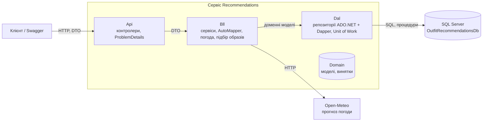
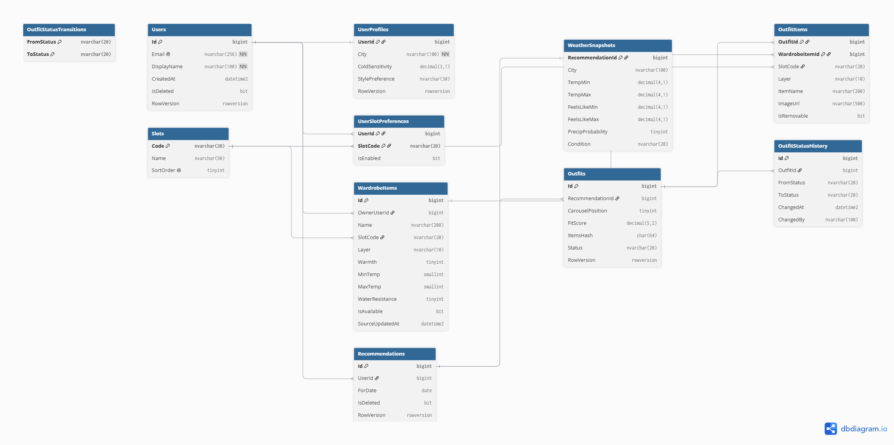
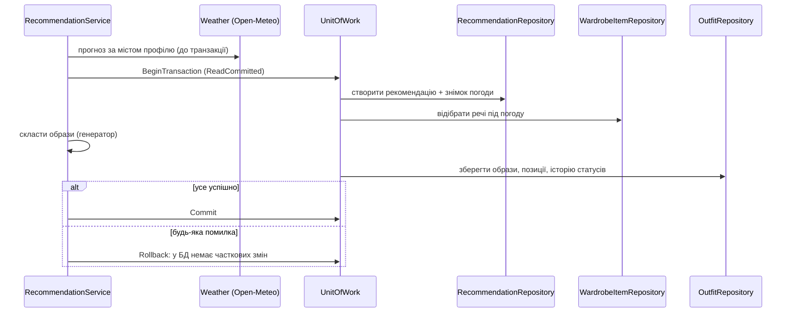

# Сервіс «Рекомендації» (Лаб. 02: ADO.NET + Dapper)

> Детальний опис першого сервісу платформи. Загальний опис, запуск усієї платформи й сервіс «Гардероб» (Лаб. 03) див. у [головному README](../README.md).

Мікросервіс підбирає образи з власного гардероба користувача під погоду. Користувач один раз вказує місто в профілі, а далі система **сама** отримує прогноз на день, відбирає речі, що підходять під погоду (у сніг без шортів і кросівок, у дощ лише водостійкі куртки й взуття, речі в пранні й вимкнені слоти пропускаються), і складає кілька образів для каруселі за слотами: верх (із шарами), низ, взуття, сумка, аксесуари. Образ, який людина вже одягала за останні дні, повторно не пропонується.

Репозиторій містить:
- **Лаб. 01:** проєктування трьох баз даних для мікросервісної архітектури (скрипти в [`db/`](../db), опис у [`docs/lab01-report.md`](lab01-report.md));
- **Лаб. 02:** реалізація мікросервісу «Рекомендації» (Проєкт №1, SQL Server): тришарова архітектура на ADO.NET + Dapper, запуск через .NET Aspire.

## Зміст

1. [Архітектура](#архітектура)
2. [Структура репозиторію](#структура-репозиторію)
3. [Що потрібно для запуску](#що-потрібно-для-запуску)
4. [Запуск через Aspire (рекомендовано)](#запуск-через-aspire-рекомендовано)
5. [Запуск без Docker](#запуск-без-docker)
6. [Розгортання баз даних](#розгортання-баз-даних)
7. [API: ендпоінти й приклади запитів](#api-ендпоінти-й-приклади-запитів)
8. [Обробка помилок](#обробка-помилок)
9. [Транзакційна бізнес-операція](#транзакційна-бізнес-операція)
10. [Транзакції: рівень ізоляції й таймаути](#транзакції-рівень-ізоляції-й-таймаути)
11. [Автоматична погода](#автоматична-погода)
12. [Політика дублювання даних](#політика-дублювання-даних)
13. [Перевірка роботи](#перевірка-роботи)
14. [Робота з Git](#робота-з-git)

---

## Архітектура

Залежності спрямовані в один бік: **Api → Bll → Dal**, а **Domain** (моделі, винятки, константи) підключають і Dal, і Bll. Контролер ніколи не звертається до репозиторію напряму, лише через сервіс; SQL є **тільки** в Dal.



| Проєкт | Призначення |
|---|---|
| `Recommendations.Api` | Web API: контролери з атрибутною маршрутизацією, глобальна обробка помилок (ProblemDetails), Swagger, кореляційний Id, `Program.cs` з DI |
| `Recommendations.Bll` | Сервіси та бізнес-правила, DTO, профілі AutoMapper, провайдер погоди, генератор образів, валідація |
| `Recommendations.Dal` | Інтерфейси репозиторіїв (`IGenericRepository<T>`), реалізації (ADO.NET та Dapper), Unit of Work, переклад помилок SQL |
| `Recommendations.Domain` | Моделі, доменні винятки (`NotFoundException`, `BusinessConflictException`, `ValidationException`), константи |
| `Platform.AppHost` | Оркестрація .NET Aspire: SQL Server, ініціалізація БД, запуск API |

### Репозиторії

| Репозиторій | Технологія | Особливість |
|---|---|---|
| `UserRepository` | **чистий ADO.NET** (`SqlCommand`, `SqlDataReader`) | свідомо **не** успадковує Generic Repository |
| `WardrobeItemRepository` | ADO.NET + **Dapper** | наслідує `BaseDapperRepository<T>`; процедури `usp_GetEligibleItems`, `usp_UpsertWardrobeItemCopy` |
| `OutfitRepository` | ADO.NET + **Dapper** | multi-mapping (образ + позиції одним запитом); процедури `usp_AddOutfit`, `usp_ChangeOutfitStatus` |
| `RecommendationRepository` | ADO.NET + **Dapper** | multi-mapping (рекомендація + погода); процедура `usp_CreateRecommendation` |

Усі значення в запити передаються лише **параметрами** (жодної конкатенації з вхідними даними), з'єднання та команди звільняються через `using` / `await using`.

## Структура репозиторію

```text
.
├── README.md
├── Platform.slnx                  одне рішення на всю платформу
├── Platform.AppHost/              оркестрація Aspire (AppHost.cs)
├── Services/
│   └── Recommendations/
│       ├── Recommendations.Api/
│       ├── Recommendations.Bll/
│       ├── Recommendations.Dal/
│       └── Recommendations.Domain/
├── db/
│   ├── p1/                        SQL Server: schema.sql, procedures.sql, seed.sql, tests.sql
│   ├── p2/                        SQL Server: schema.sql, seed.sql
│   └── p3/                        MongoDB: collections.js, seed.js, queries.js
└── docs/                          ERD, карта контекстів, опис Лаб. 01
```


## Що потрібно для запуску

- **.NET SDK 9 або 10** (перевірка: `dotnet --version`)
- **Docker Desktop**, запущений (для запуску бази в контейнері через Aspire); без Docker див. [Запуск без Docker](#запуск-без-docker)
- Для ручного розгортання БД: SQL Server (локально або в Docker), SSMS чи `sqlcmd`; для Проєкту №3: MongoDB та `mongosh`

## Запуск через Aspire (рекомендовано)

Aspire піднімає SQL Server у контейнері, застосовує до нього скрипти з `db/p1` (схема, процедури, тестові дані) і запускає API з готовим рядком підключення. **Одна команда**:

```bash
dotnet run --project Platform.AppHost
```

1. Перший запуск довший: Docker завантажує образ SQL Server.
2. У консолі з'явиться посилання на **Aspire Dashboard** (`https://localhost:17xxx/login?t=...`), відкрий його.
3. У Dashboard ресурси `sql`, `RecommendationsDb` і `recommendations-api` мають перейти в статус **Running**.
4. У консолі AppHost видно ініціалізацію бази: `Applying schema.sql`, `Applying procedures.sql`, `Applying seed.sql`, `Database scripts applied`.
5. В рядку `recommendations-api` колонка **Endpoints** містить адресу API. Додай до неї `/swagger`: відкриється Swagger UI з описом усіх ендпоінтів.

Скрипти ідемпотентні, тому повторні запуски не створюють дублікатів. Зупинка: **Ctrl+C**.

Як це працює: ім'я ресурсу бази в `AppHost.cs` (`RecommendationsDb`) збігається з іменем рядка підключення в API (`GetConnectionString("RecommendationsDb")`), тому Aspire передає рядок у сервіс змінною оточення `ConnectionStrings__RecommendationsDb`, а код API змінювати не потрібно.

## Запуск без Docker

Якщо Docker недоступний, використовується існуюча база з Лаб. 01 на локальному SQL Server (Варіант 1 методички).

1. Розгорни базу `OutfitRecommendationsDb` за розділом [Розгортання баз даних](#розгортання-баз-даних).
2. Вкажи рядок підключення в `Platform.AppHost/appsettings.json` (для AppHost) або в `Services/Recommendations/Recommendations.Api/appsettings.json` (для окремого запуску API):

   ```json
   "ConnectionStrings": {
     "RecommendationsDb": "Server=localhost\\SQLEXPRESS;Database=OutfitRecommendationsDb;Trusted_Connection=True;TrustServerCertificate=True"
   }
   ```

   Ім'я сервера (`localhost\\SQLEXPRESS` або `localhost`) має відповідати твоєму екземпляру SQL Server.
3. Запуск: `dotnet run --project Platform.AppHost`, або лише API без Aspire:

   ```bash
   dotnet run --project Services/Recommendations/Recommendations.Api
   ```

   Адреса й порт видно в консолі (`Now listening on: ...`), Swagger: `/swagger`.

Рядок підключення можна перевизначити змінною оточення (подвійне підкреслення замість двокрапки):

```bash
export ConnectionStrings__RecommendationsDb="Server=...;Database=OutfitRecommendationsDb;..."
```

## Розгортання баз даних

Усі скрипти ідемпотентні: повторний запуск не створює дублікатів. Файли виконуються **по черзі**.

| База | Скрипти | Порядок |
|---|---|---|
| Проєкт №1 `OutfitRecommendationsDb` (SQL Server) | `db/p1/` | `schema.sql` → `procedures.sql` → `seed.sql` (перевірка: `tests.sql`) |
| Проєкт №2 `WardrobeDb` (SQL Server) | `db/p2/` | `schema.sql` → `seed.sql` |
| Проєкт №3 `outfitFeedbackDb` (MongoDB) | `db/p3/` | `collections.js` → `seed.js` (запити: `queries.js`) |

**SQL Server (SSMS):** відкрий файл (File → Open → File), натисни **F5**, кожен файл у новому вікні запиту. **sqlcmd** потребує прапорця `-I` (QUOTED_IDENTIFIER ON), інакше фільтровані індекси не створяться:

```bash
sqlcmd -S localhost -E -I -i db/p1/schema.sql
sqlcmd -S localhost -E -I -i db/p1/procedures.sql
sqlcmd -S localhost -E -I -i db/p1/seed.sql
```

**MongoDB:**

```bash
mongosh "mongodb://localhost:27017" --file db/p3/collections.js
mongosh "mongodb://localhost:27017" --file db/p3/seed.js
```

За запуску через Aspire база Проєкту №1 створюється автоматично; для Проєктів №2 і №3 потрібне ручне розгортання (з ними працюватимуть наступні лабораторні).



## API: ендпоінти й приклади запитів

Повний опис із моделями та статусами: **Swagger UI** (`/swagger`).

| Метод і шлях | Призначення | Успіх | Помилки |
|---|---|---|---|
| `GET /api/users` | список користувачів | 200 | |
| `GET /api/users/{id}` | користувач | 200 | 404 |
| `POST /api/users` | створити користувача | 201 + `Location` | 400, 409 |
| `DELETE /api/users/{id}` | видалити (м'яко) | 204 | 404 |
| `GET /api/users/{id}/profile` | профіль (місто, координати) | 200 | 404 |
| `PUT /api/users/{id}/profile` | зберегти профіль | 200 | 400, 404 |
| `GET /api/users/{userId}/wardrobe?slot=Top` | речі гардероба (за слотом) | 200 | 400, 404 |
| `GET /api/wardrobe-items/{id}` | річ | 200 | 404 |
| `PUT /api/wardrobe-items/{id}` | додати або оновити річ | 200 | 400, 404 |
| `DELETE /api/wardrobe-items/{id}` | видалити річ | 204 | 404 |
| **`POST /api/recommendations`** | **створити рекомендацію (транзакційна операція)** | 201 + `Location` | 400, 404, 409, 503 |
| `GET /api/recommendations/{id}` | рекомендація з погодою й образами | 200 | 404 |
| `GET /api/recommendations/{id}/eligible-items` | речі, що підходять під погоду | 200 | 404 |
| `GET /api/users/{userId}/recommendations?page=1&pageSize=10` | історія рекомендацій | 200 | 400, 404 |
| `GET /api/outfits/{id}` | образ з позиціями | 200 | 404 |
| `POST /api/outfits/{id}/status` | змінити статус образу | 200 | 400, 404, **409** |
| `DELETE /api/outfits/{id}` | видалити образ | 204 | 404 |

Приклади `curl` (замість `$API` підстав адресу API з Dashboard, наприклад `export API=http://localhost:5080`). Користувачі 1 (Олена) і 2 (Макс) є в тестових даних.

```bash
# 1. Профіль: користувач указує місто один раз, погоду НЕ вводить
curl -X PUT "$API/api/users/1/profile" -H "Content-Type: application/json" \
  -d '{"city":"Тернопіль","latitude":49.553516,"longitude":25.594767,"coldSensitivity":1.0,"stylePreference":"Casual"}'

# 2. Створити рекомендацію: погода автоматично, 3 образи для каруселі
curl -X POST "$API/api/recommendations" -H "Content-Type: application/json" \
  -d '{"userId":1,"outfitCount":3}'

# 3. Переглянути рекомендацію з образами (Id із відповіді вище)
curl "$API/api/recommendations/1"

# 4. Обрати образ: Generated -> Chosen
curl -X POST "$API/api/outfits/1/status" -H "Content-Type: application/json" \
  -d '{"status":"Chosen"}'

# 5. Історія рекомендацій користувача
curl "$API/api/users/1/recommendations?page=1&pageSize=10"
```

Готові запити також є у файлі `Services/Recommendations/Recommendations.Api/Recommendations.Api.http` (Visual Studio / VS Code).

## Обробка помилок

Усі помилки повертаються у стандартному форматі **ProblemDetails** (RFC 9457). Перетворення винятків на статуси виконує **один** глобальний обробник (`DomainExceptionHandler`), у контролерах немає `try/catch`.

Ланцюжок: процедура БД (`THROW`) → **Dal** перехоплює `SqlException` і перетворює на доменний виняток → **Bll** → глобальний обробник → HTTP-статус.

| Джерело | Доменний виняток | Статус |
|---|---|---|
| `THROW 50001/50003/50021/50031/50041` (не знайдено), порожній результат | `NotFoundException` | **404** |
| `THROW 50012–50015`, `50022` (недопустимий перехід статусу), `50023`, порушення UNIQUE (2601, 2627), FK (547) | `BusinessConflictException` | **409** |
| `THROW 50011`, помилки DataAnnotations, бізнес-валідація в Bll | `ValidationException` | **400** |
| сервіс погоди недоступний | `ExternalServiceException` | **503** |
| будь-яка інша помилка | (без деталей клієнту) | **500** |

Приклад відповіді 409 (спроба одягнути образ, який не було обрано):

```json
{
  "type": "https://tools.ietf.org/html/rfc9110#section-15.5.10",
  "title": "Business rule conflict",
  "status": 409,
  "detail": "Invalid status transition: Generated -> Worn",
  "traceId": "0HN...",
  "correlationId": "5c1f0e2b7d3a4e8f9a6b1c2d3e4f5a6b"
}
```

Приклад 404: `GET /api/outfits/999999` повертає `status: 404`, `detail: "Outfit 999999 not found"` (а не 500).

Кореляційний Id повертається в заголовку `X-Correlation-Id` і потрапляє в усі логи запиту. У логи не записуються паролі, токени чи інші секрети.

## Транзакційна бізнес-операція

`POST /api/recommendations` змінює **кілька таблиць через кілька репозиторіїв в одній транзакції** (Unit of Work):



Якщо підходящих речей немає (потрібен хоча б один верх і один низ) або будь-який крок падає, **відкочується все**: у базі не лишається рекомендації без образів. HTTP-запит до сервісу погоди виконується **до** відкриття транзакції, щоб не тримати блокування БД під час очікування мережі.

Зміна статусу образу (`POST /api/outfits/{id}/status`) виконується процедурою `usp_ChangeOutfitStatus`: у явній транзакції, з блокуванням рядка (`UPDLOCK`) і перевіркою переходу за таблицею `OutfitStatusTransitions`: `Generated → Chosen → Worn → Reviewed`; скасувати (`Cancelled`) можна лише до `Worn`. Недопустимий перехід повертає **409**.

## Транзакції: рівень ізоляції й таймаути

- **Рівень ізоляції:** `ReadCommitted` (рівень SQL Server за замовчуванням), задається в `UnitOfWork.BeginTransactionAsync`. Він запобігає «брудному» читанню та не створює надмірних блокувань. Для нашої операції (кілька вставок і читання власних щойно вставлених рядків у тій самій транзакції) цього достатньо.
- **Компроміс deadlocks vs consistency:** вищий рівень ізоляції (`RepeatableRead`, `Serializable`) дає менше аномалій читання, але більше блокувань і вищий ризик взаємних блокувань (deadlock). Тому без потреби його не підвищуємо.
- **Захист від конкурентних змін:** pessimistic, через `UPDLOCK` у процедурі зміни статусу (конфлікт запобігається заздалегідь); додатково в таблицях є `ROWVERSION` для optimistic-перевірки; фільтрований унікальний індекс гарантує не більше одного обраного образу на рекомендацію.
- **Таймаути:** команди SQL використовують таймаут `SqlClient` за замовчуванням (30 с); запит до сервісу погоди обмежений 10 секундами. Одна транзакція живе лише протягом одного HTTP-запиту (Unit of Work має час життя Scoped).
- **Відкат:** процедури мають `SET XACT_ABORT ON`, тому після помилки SQL Server сам відкочує транзакцію; `UnitOfWork.RollbackAsync` це враховує й безпечно завершується.

## Автоматична погода

Користувач **не вводить** погоду. Він один раз зберігає в профілі місто та координати, а сервіс сам запитує прогноз на потрібний день.

- **Реальний провайдер:** [Open-Meteo](https://open-meteo.com/) (безкоштовний, ключ не потрібен): температура, «відчувається як», ймовірність опадів, вітер, УФ-індекс, тип погоди.
- **Демо без інтернету:** налаштування `Weather:Provider = Fake` (в `appsettings.json` API або змінною `Weather__Provider=Fake`) вмикає детермінований провайдер, що за датою віддає сніг, хмарну погоду, спеку або дощ.
- **Знімок:** погода на момент підбору зберігається в `WeatherSnapshots`, тож згодом видно, чому порадили саме цей одяг.

Правила підбору речей (процедура `usp_GetEligibleItems`): ефективна температура = «відчувається як» мінус `ColdSensitivity × 2`; діапазон комфорту речі має перетинатися з діапазоном дня; низ і взуття мають витримувати найхолодніший момент; при опадах взуття та верхній шар куртки мають достатню водостійкість; речі в пранні та вимкнені користувачем слоти не показуються.

## Політика дублювання даних

Між базами немає FOREIGN KEY; знання про чужі сутності зберігаються як ідентифікатори й дублі полів. Нижче поля, що стосуються цього сервісу (повна таблиця для всіх баз: [`docs/lab01-report.md`](lab01-report.md), розділ 8).

| Поле | Де зберігається | Власник даних | Політика узгодженості |
|---|---|---|---|
| `OutfitItems.ItemName`, `ImageUrl`, `SlotCode`, `Layer` | БД «Рекомендації» | WardrobeItems (БД «Гардероб») | **Знімок** на момент створення образу, не оновлюється |
| `WardrobeItems.Name`, `SlotCode`, `Layer`, `Warmth`, `MinTemp`, `MaxTemp`, `WaterResistance`, `IsAvailable`, `PrimaryImageUrl` | БД «Рекомендації» (локальна копія) | БД «Гардероб» | **Копія для читання**, оновлюється подією (`PUT /api/wardrobe-items/{id}` імітує її); застарілі події ігноруються за `SourceUpdatedAt` |
| `WardrobeItems.OwnerUserId` | БД «Гардероб» | Users (БД «Рекомендації») | лише посилання за Id, без FK |
| `outfitFeedback.outfitId` | MongoDB | Outfits (БД «Рекомендації») | лише посилання за Id, без FK |
| `UserProfiles.ColdSensitivity` | БД «Рекомендації» | БД «Рекомендації» | похідне значення; Відгуки лише публікують подію, перерахунок виконує цей сервіс |

Механізм доставки подій (eventual consistency) буде реалізовано в Лаб. 08.

## Перевірка роботи

1. **Спецсимволи:** створити користувача з `displayName` `O'Brien` (`POST /api/users` у Swagger): помилки SQL немає, бо значення параметризовані.
2. **Відкат транзакції:** `POST /api/recommendations` для користувача з профілем, але без речей у гардеробі, повертає **409**, а в таблицях `Recommendations`, `WeatherSnapshots`, `Outfits` кількість рядків не змінюється.
3. **409:** `POST /api/outfits/{id}/status` з `{"status":"Worn"}` для образу в статусі `Generated`: відповідь 409 у форматі ProblemDetails, статус не змінився.
4. **404:** `GET /api/outfits/999999` повертає 404, а не 500.
5. **400:** `POST /api/users` з порожнім `email` повертає 400.
6. **Aspire:** `dotnet run --project Platform.AppHost`: у Dashboard `sql`, `RecommendationsDb` і `recommendations-api` мають статус **Running**.
7. **Swagger:** `/swagger` відкривається, кожен ендпоінт викликається вручну, статуси відповідей збігаються з таблицею вище.
8. **Скрипти БД:** повторний запуск `db/p1/seed.sql` не створює дублікатів.

## Робота з Git

- Кожна лабораторна розробляється в **окремій гілці** (`lab-01`, `lab-02`, ...), що відгалужується від попередньої.
- Усередині лаби кожне завдання виконується в гілці `feature/...`, яка зливається в гілку лаби через **Pull Request** з описом змін (`feature/domain`, `feature/dal`, `feature/bll`, `feature/api`, `feature/aspire`).
- Повідомлення комітів описують зміну (наприклад, `Dal: repositories (ADO.NET + Dapper), Unit of Work`).

## Примітка про AutoMapper

Починаючи з версії 15.0 AutoMapper розповсюджується за комерційною ліцензією з безкоштовною Community-редакцією (навчальне та некомерційне використання). Без ліцензійного ключа (`AutoMapper:LicenseKey` в `appsettings.json`) застосунок працює, але записує в лог повідомлення про відсутність ключа.
