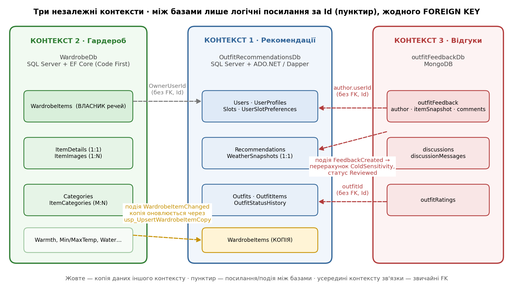
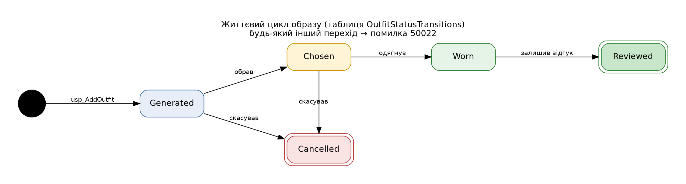
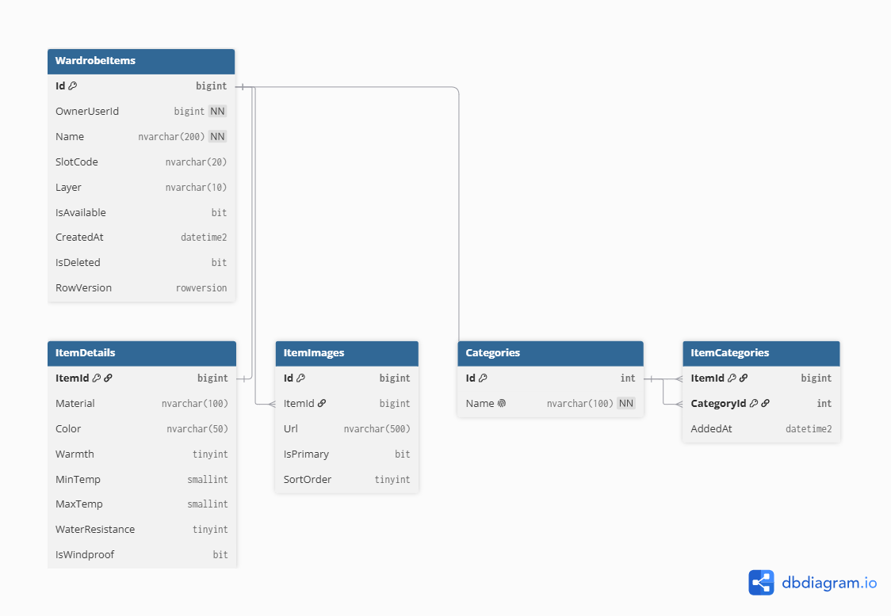
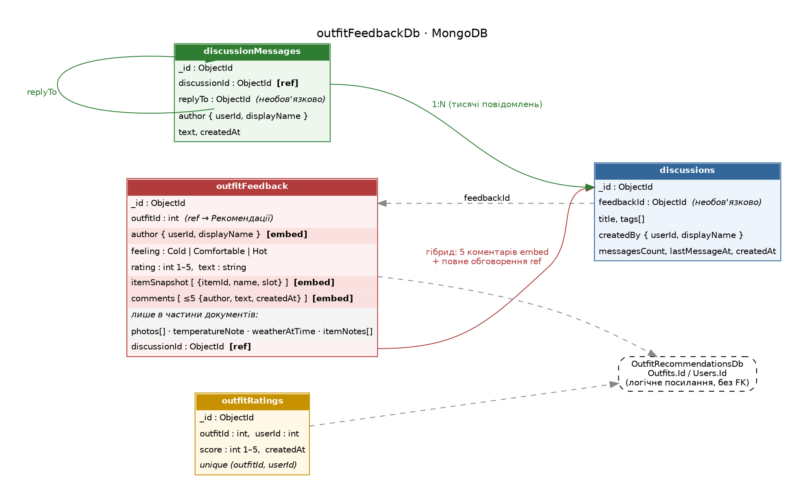

<<<<<<< HEAD
# Практичне заняття №01. Бази даних для мікросервісної архітектури
=======
Wardrobe & Weather Outfits — бази даних для мікросервісної архітектури
>>>>>>> a3eb33ba6355caa95e0f2aabfc12ae1e5a6cf7f8

**Предметна область:** застосунок підбору одягу з власного гардероба за погодою.

## Мета роботи

Дослідити практичні аспекти реалізації баз даних предметної області для мікросервісної архітектури: виділення незалежних контекстів і розподіл даних між ними, реляційне моделювання (ключі, зв'язки, обмеження, індекси, збережувані процедури), документо-орієнтоване моделювання в MongoDB (вбудовування та посилання), визначення політики дублювання даних і узгодженості між базами.

## Зміст

1. [Опис предметної області](#1-опис-предметної-області)
2. [Контексти (Bounded Contexts) і їх сутності](#2-контексти-bounded-contexts-і-їх-сутності)
3. [Агрегати та межі даних](#3-агрегати-та-межі-даних)
4. [Вибір технології персистентності](#4-вибір-технології-персистентності)
5. [Проєкт №1. База «Рекомендації» (SQL Server)](#5-проєкт-1-база-рекомендації-sql-server)
6. [Проєкт №2. База «Гардероб» (SQL Server, EF Core)](#6-проєкт-2-база-гардероб-sql-server-ef-core)
7. [Проєкт №3. База «Відгуки та спільнота» (MongoDB)](#7-проєкт-3-база-відгуки-та-спільнота-mongodb)
8. [Політика дублювання даних і узгодженості](#8-політика-дублювання-даних-і-узгодженості)
9. [Розгортання баз з нуля](#9-розгортання-баз-з-нуля)
10. [Відповідність критеріям приймання](#10-відповідність-критеріям-приймання)
11. [Відповіді на контрольні питання](#11-відповіді-на-контрольні-питання)
12. [Висновки](#12-висновки)
13. [Додатки](#додаток-а-склад-репозиторію)

---

## 1. Опис предметної області

Системою користуються люди, які хочуть щодня швидко підбирати одяг із власного гардероба під погоду. Користувач створює профіль (місто, чутливість до холоду, стиль), додає свої речі та за потреби вимикає непотрібні слоти, наприклад аксесуари. Щодня система бере погоду на день (температура, «відчувається як», ймовірність опадів, вітер, тип погоди) і складає кілька образів, які показуються у вигляді каруселі.

Образ складається зі слотів: **верх** (із шарами: базовий, середній, верхній), **низ**, **взуття**, **сумка**, **аксесуари**. Підбір не випадковий: у каруселі присутні лише речі, які підходять під погоду. Наприклад, під час снігу шортів і кросівок там не буде. Речі в пранні, а також вимкнені слоти до каруселі не потрапляють. Образ, який людина вже одягала за останні дні, повторно не пропонується. Після носіння користувач залишає відгук («замерз / комфортно / жарко»), що дає змогу згодом уточнювати підбір.

## 2. Контексти (Bounded Contexts) і їх сутності

Систему розбито на три незалежні контексти. Кожен має власну базу даних і автономну модель, а зовнішніх ключів між базами немає: сутність належить рівно одному контексту, інші знають про неї лише за ідентифікатором.

| № | Контекст | База даних | Технологія | Власні сутності |
|---|---|---|---|---|
| 1 | Рекомендації | `OutfitRecommendationsDb` | SQL Server + ADO.NET/Dapper | Users, UserProfiles, Slots, UserSlotPreferences, Recommendations, WeatherSnapshots, Outfits, OutfitItems, OutfitStatusTransitions, OutfitStatusHistory; WardrobeItems (лише копія для читання) |
| 2 | Гардероб | `WardrobeDb` | SQL Server + EF Core (Code First) | WardrobeItems, ItemDetails, ItemImages, Categories, ItemCategories |
| 3 | Відгуки та спільнота | `outfitFeedbackDb` | MongoDB | outfitFeedback, discussions, discussionMessages, outfitRatings |



*Рис. 1. Карта контекстів: суцільні лінії — зв'язки всередині бази, пунктир — лише логічні посилання за ідентифікатором або події (без FOREIGN KEY).*

Дані про погоду не винесено в окрему базу: їх надає зовнішнє API, а в контексті «Рекомендації» зберігається знімок погоди на момент підбору, щоб потім було зрозуміло, чому порадили саме цей одяг.

## 3. Агрегати та межі даних

- **Рекомендація** = Recommendation + WeatherSnapshot + Outfits + OutfitItems + OutfitStatusHistory. Образи та їхні позиції не існують без рекомендації й змінюються лише через неї.
- **Річ гардероба** = WardrobeItem + ItemDetail + ItemImages + ItemCategories.
- **Відгук** = outfitFeedback із вбудованими автором, знімком речей і кількома коментарями.
- **Обговорення** = discussions + discussionMessages. Повідомлень може бути необмежено багато, тому вони винесені в окрему колекцію.

Дублювання даних між контекстами описано в [розділі 8](#8-політика-дублювання-даних-і-узгодженості).

## 4. Вибір технології персистентності

| Проєкт | Технологія | Обґрунтування |
|---|---|---|
| №1 Рекомендації | SQL Server + ADO.NET/Dapper | транзакційний процес зі статусами образу, строгі зв'язки, збережувані процедури, перевірка цілісності |
| №2 Гардероб | SQL Server + EF Core | багато сутностей і різні типи зв'язків (1:1, 1:N, M:N), зручно показати Fluent API, seed-дані й міграції |
| №3 Відгуки | MongoDB | відгуки мають змінну структуру (фото, нотатки, погода на момент носіння), вкладені коментарі, необмежені обговорення |

---

## 5. Проєкт №1. База «Рекомендації» (SQL Server)

### 5.1. Таблиці та зв'язки

| Тип зв'язку | Приклад у базі | Де розміщено зовнішній ключ |
|---|---|---|
| 1:1 | Users – UserProfiles; Recommendations – WeatherSnapshots | зовнішній ключ є одночасно первинним ключем залежної таблиці |
| 1:N | Users → Recommendations; Recommendations → Outfits; Outfits → OutfitStatusHistory | зовнішній ключ у таблиці на боці «багатьох» |
| M:N | Outfits ↔ WardrobeItems через OutfitItems; Users ↔ Slots через UserSlotPreferences (власне поле IsEnabled) | окрема проміжна таблиця з двома зовнішніми ключами |

Таблиця **WardrobeItems** у цій базі є локальною копією довідника з бази «Гардероб»: її Id збігається з Id у базі-власнику (тому не IDENTITY), а зовнішнього ключа на іншу базу немає.

### 5.2. ERD


*Рис. 2. ERD бази «Рекомендації».*

### 5.3. Ключі, обмеження, аудит і конкурентність

- **Первинні ключі:** `BIGINT IDENTITY`. Вставка в кожну базу йде з одного джерела, ключ компактний і послідовний, що дає менше фрагментації індексів. Id речі генерує сервіс гардероба, а рекомендації зберігають той самий Id.
- **Обмеження:**
  - `UNIQUE`: Email, SortOrder слота, пара «рекомендація + позиція в каруселі», пара «рекомендація + відбиток образу», пара «образ + слот + шар».
  - `CHECK`: теплота 1–5, водостійкість 0–3, `MaxTemp > MinTemp`, ймовірність опадів 0–100, `FitScore` 0–100, чутливість до холоду від −3 до 3, допустимі значення статусів, шару та погоди, шари лише для слота «верх».
  - `DEFAULT`: статус `Generated`, дати через `SYSUTCDATETIME()`, `IsEnabled = 1`, `IsAvailable = 1`, `IsDeleted = 0`.
- **Каскади:** каскадне видалення застосовано лише всередині агрегатів (профіль, погодний знімок, образи, позиції, історія статусів). Для `Recommendations.UserId` каскаду немає, щоб історія не зникала разом з користувачем.
- **Аудит і м'яке видалення:** у таблицях Users, UserProfiles, Recommendations, Outfits є `CreatedAt`, `CreatedBy`, `UpdatedAt`, `UpdatedBy`, `IsDeleted`.
- **Оптимістична конкурентність:** стовпець `ROWVERSION` у профілі, рекомендаціях і образах. Профіль можуть одночасно змінити користувач і подія з відгуку, а образ можуть змінити з двох пристроїв; `rowversion` не дає одному запису «тихо» затерти зміни іншого.

### 5.4. Індекси та запити, під які вони створені

| Індекс | Запит |
|---|---|
| `IX_WardrobeItems_Eligible` (OwnerUserId, SlotCode) INCLUDE (...) WHERE IsAvailable = 1 AND IsDeleted = 0 | усі доступні речі користувача в слоті для каруселі (покриваючий, фільтрований) |
| `IX_Recommendations_User_Date` (UserId, ForDate DESC) WHERE IsDeleted = 0 | історія рекомендацій користувача |
| `IX_Outfits_ItemsHash` (ItemsHash) INCLUDE (RecommendationId, Status) | чи вже носили такий самий образ нещодавно |
| `UX_Outfits_OneActivePerRecommendation` (RecommendationId) WHERE Status не Generated і не Cancelled | на одну рекомендацію лише один обраний або одягнений образ |
| `IX_OutfitItems_WardrobeItemId` | у яких образах використовувалась річ (зворотний пошук по M:N) |
| `IX_OSH_Outfit_ChangedAt` (OutfitId, ChangedAt) | історія статусів образу за часом |

### 5.5. Статуси образу



*Рис. 3. Життєвий цикл образу.*

Образ проходить шлях `Generated → Chosen → Worn → Reviewed`. Скасувати його (`Cancelled`) можна лише з `Generated` або `Chosen`, тобто до того, як його одягнули. Допустимі переходи зберігаються не в коді, а в таблиці `OutfitStatusTransitions`, тому правила можна змінювати даними без перекомпіляції. Кожна зміна статусу записується в `OutfitStatusHistory`.

### 5.6. Збережувані процедури

У базі реалізовано 6 процедур: CRUD та бізнес-операції з транзакційною логікою.

| Процедура | Операція | Що робить | Коди помилок |
|---|---|---|---|
| `usp_CreateRecommendation` | Create | створює рекомендацію та знімок погоди в одній транзакції | 50001 |
| `usp_GetEligibleItems` | Read | повертає речі, придатні для погоди, з урахуванням чутливості до холоду, вимкнених слотів, прання та водостійкості | 50003 |
| `usp_AddOutfit` | Create (транзакція) | додає образ зі списку речей (JSON): перевіряє власника, доступність, слоти, дублікати й повтор за N днів; пише відбиток образу, знімок позицій і початкову історію | 50003, 50011–50015 |
| `usp_ChangeOutfitStatus` | Update (транзакція) | змінює статус із блокуванням рядка, перевіркою переходу за таблицею та записом в історію | 50021–50023 |
| `usp_SetSlotEnabled` | Update (upsert) | вмикає або вимикає слот для користувача | 50001, 50031 |
| `usp_UpsertWardrobeItemCopy` | Upsert | синхронізує локальну копію речі з Гардероба; застарілі події ігноруються за `SourceUpdatedAt` | 50041 |

**Коди помилок:** 50001 користувача не знайдено · 50003 рекомендацію не знайдено · 50011 порожній образ · 50012 речі чужі, недоступні або слот вимкнено · 50013 дві речі в одному слоті й шарі · 50014 образ уже одягали нещодавно · 50015 такий образ уже є в каруселі · 50021 образ не знайдено · 50022 недопустимий перехід статусу · 50023 інший образ уже обрано · 50031 слот не знайдено · 50041 власника речі не знайдено.

Найскладніша частина — транзакційна процедура зміни статусу. Вона працює в явній транзакції, блокує рядок образу через `UPDLOCK` до кінця транзакції, відмовляє керованою помилкою на недопустимому переході й не дає обрати другий образ у тій самій рекомендації:

```sql
CREATE OR ALTER PROCEDURE dbo.usp_ChangeOutfitStatus
    @OutfitId BIGINT, @NewStatus NVARCHAR(20),
    @ChangedBy NVARCHAR(100) = NULL, @Note NVARCHAR(500) = NULL
AS
BEGIN
    SET NOCOUNT ON;
    SET XACT_ABORT ON;   -- будь-яка помилка відкочує транзакцію
    BEGIN TRANSACTION;

    DECLARE @Current NVARCHAR(20), @RecId BIGINT;
    SELECT @Current = Status, @RecId = RecommendationId
    FROM dbo.Outfits WITH (UPDLOCK)          -- блокуємо рядок до кінця транзакції
    WHERE Id = @OutfitId AND IsDeleted = 0;

    IF @Current IS NULL
        THROW 50021, 'Outfit not found', 1;

    IF NOT EXISTS (SELECT 1 FROM dbo.OutfitStatusTransitions
                   WHERE FromStatus = @Current AND ToStatus = @NewStatus)
        THROW 50022, 'Invalid status transition', 1;

    IF @NewStatus = N'Chosen' AND EXISTS (SELECT 1 FROM dbo.Outfits
            WHERE RecommendationId = @RecId AND Id <> @OutfitId AND IsDeleted = 0
              AND Status IN (N'Chosen', N'Worn', N'Reviewed'))
        THROW 50023, 'Another outfit is already chosen', 1;

    UPDATE dbo.Outfits SET Status = @NewStatus, UpdatedAt = SYSUTCDATETIME(), UpdatedBy = @ChangedBy
    WHERE Id = @OutfitId;

    INSERT dbo.OutfitStatusHistory (OutfitId, FromStatus, ToStatus, ChangedBy, Note)
    VALUES (@OutfitId, @Current, @NewStatus, @ChangedBy, @Note);

    COMMIT TRANSACTION;
END
```

### 5.7. Правила підбору речей для каруселі

Процедура `usp_GetEligibleItems` відсіює непідходящі речі ще до показу, тому у снігу в каруселі не з'явиться жодних шортів. Правила такі:

1. Ефективна температура = «відчувається як» мінус `ColdSensitivity` × 2. Чим більше людина мерзне, тим тепліший одяг їй підбирається.
2. Діапазон комфорту речі (`MinTemp…MaxTemp`) має перетинатися з діапазоном ефективної температури дня.
3. Низ і взуття не зняти протягом дня, тому вони мають витримувати найхолодніший момент: `MinTemp` не вище ефективного мінімуму плюс 3 градуси.
4. За опадів (дощ, сніг, гроза або ймовірність від 50%) взуття та верхній шар куртки мають `WaterResistance` не менше 2.
5. Речі в пранні (`IsAvailable = 0`), видалені речі та вимкнені користувачем слоти до вибірки не потрапляють.

**Приклад.** Сніг 15 грудня, відчувається як від −9 до −3, чутливість до холоду користувачки +1. Ефективний діапазон — від −11 до −5. У вибірці лишаються пухова куртка, светр, футболка як базовий шар, термо-лонгслів, утеплені джинси, зимові черевики, шапка, шарф і дві сумки. Шортів, класичних джинсів, кросівок, легкої вітровки та сонцезахисних окулярів там немає.

**Без повторів.** Образ має відбиток `ItemsHash` (SHA-256 від відсортованих Id речей): `usp_AddOutfit` відмовляє з помилкою 50014, якщо такий самий набір одягали (`Worn` або `Reviewed`) за останні 3 дні.

### 5.8. Тестові дані та перевірка

`seed.sql` наповнює базу довідниками (слоти, дозволені переходи статусів), двома користувачами з профілями, 21 річчю гардероба та двома рекомендаціями: 08.10 з одягнутим і оціненим образом, 15.12 зі снігом і двома образами в каруселі. Перед кожною вставкою перевіряється наявність запису, тому повторний запуск дублікатів не створює.

`tests.sql` перевіряє основні сценарії:

| Перевірка | Очікуваний результат |
|---|---|
| `SELECT * FROM sys.foreign_keys` | усі зовнішні ключі лише всередині цієї бази |
| підбір речей для снігу | лише теплі та водостійкі речі, без шортів і кросівок |
| вимкнення слота Accessory | шапки й шарфа у вибірці немає |
| річ у пранні (`IsAvailable = 0`) | зимові черевики зникають із вибірки |
| перехід Generated → Worn | керована помилка 50022, дія не виконується |
| другий образ → Chosen | помилка 50023 |
| перехід Cancelled → Chosen | помилка 50022 |
| образ, який уже одягали 08.10, пропонується 10.10 | помилка 50014 |
| чужі речі або вимкнений слот в образі | помилка 50012 |

---

## 6. Проєкт №2. База «Гардероб» (SQL Server, EF Core)

На цьому етапі спроєктовано схему бази; її реалізація засобами EF Core (Fluent API, міграції) буде в Лаб. 03. База містить 5 сутностей і всі три типи зв'язків.

### 6.1. Сутності та зв'язки

| Сутність | Призначення |
|---|---|
| WardrobeItems | речі користувачів: слот, шар, доступність (у пранні чи ні), аудит, м'яке видалення, rowversion |
| ItemDetails | матеріал, колір, теплота 1–5, діапазон температур, водостійкість, вітрозахист |
| ItemImages | фото речі, одне з яких головне |
| Categories | довідник: тип речі та сезон |
| ItemCategories | проміжна таблиця між речами й категоріями з власним полем `AddedAt` (дата додавання в категорію) |

| Тип зв'язку | Реалізація |
|---|---|
| 1:1 | WardrobeItems – ItemDetails: `ItemId` є одночасно PK і FK |
| 1:N | WardrobeItems → ItemImages: FK у таблиці на боці «багатьох» |
| M:N | WardrobeItems ↔ Categories через ItemCategories (два FK та поле `AddedAt`) |

Поле `OwnerUserId` — звичайний стовпець без FOREIGN KEY, бо користувачі належать іншому контексту.

### 6.2. ERD



*Рис. 4. ERD бази «Гардероб».*

### 6.3. Обмеження та індекси

- **CHECK:** слот лише Top, Bottom, Shoes, Bag або Accessory; шар лише Base, Mid або Outer; `Warmth` 1–5; `WaterResistance` 0–3; `MaxTemp > MinTemp`; шари дозволені лише для слота Top.
- **UNIQUE:** `Categories.Name`.
- **Каскади:** деталі, фото та зв'язки з категоріями видаляються разом із річчю. ItemCategories → Categories без каскаду, тому категорію з речами видалити не можна.
- **Аудит, soft delete, rowversion:** у WardrobeItems (оптимістична конкурентність під час редагування речі).

| Індекс | Запит |
|---|---|
| `IX_WardrobeItems_Owner_Slot` (OwnerUserId, SlotCode) INCLUDE (Name, IsAvailable), IsDeleted = 0 | гардероб користувача, відфільтрований за слотом |
| `IX_ItemCategories_CategoryId` | зворотний пошук: усі речі категорії, наприклад «Зима» |
| `UX_ItemImages_OnePrimary` (унікальний, IsPrimary = 1) | у речі лише одне головне фото |
| `IX_ItemImages_Item_Sort` (ItemId, SortOrder) | галерея фото речі у потрібному порядку |

### 6.4. Міграції та початкові дані

Скрипти схеми ідемпотентні (перед створенням перевіряється наявність об'єкта), а структура відповідає моделі EF Core Code First, тому в Лаб. 03 її буде відтворено міграціями. Початкові дані: 12 довідникових категорій (типи одягу та сезони), 21 річ для двох користувачів, їхні деталі, головні фото та зв'язки з категоріями. Ідентифікатори речей збігаються з копією в базі «Рекомендації».

---

## 7. Проєкт №3. База «Відгуки та спільнота» (MongoDB)

### 7.1. Колекції та прийоми моделювання



*Рис. 5. Колекції бази `outfitFeedbackDb`: вбудовані дані та посилання.*

База містить 4 колекції: `outfitFeedback`, `discussions`, `discussionMessages` та `outfitRatings`.

| Прийом | Де застосовано |
|---|---|
| Embedding (вбудовування) | `author`, `itemSnapshot[]`, `comments[]` (до 5), `photos[]`: ці дані завжди потрібні разом із відгуком |
| Referencing (посилання) | `discussionMessages.discussionId` та `replyTo`: повідомлень в обговоренні можуть бути тисячі |
| Гібрид | відгук містить 5 останніх коментарів і посилання `discussionId` на повне обговорення, яке підтягується оператором `$lookup` |
| Гнучка схема | в одній колекції є документи з різними наборами полів |
| Денормалізація | `author.displayName` та `itemSnapshot[].name` зберігаються у відгуку для швидкого читання |

### 7.2. Приклад документа

```javascript
{
  "_id": ObjectId("66f0c2a1b2c3d4e5f6000001"),
  "outfitId": 1,                                         // посилання на Рекомендації, без FK
  "author": { "userId": 1, "displayName": "Олена" },     // вбудований об'єкт
  "feeling": "Comfortable",
  "rating": 5,
  "text": "Вітровка і светр виручили: зранку прохолодно, а вдень светр лишився в рюкзаку.",
  "photos": ["fb1_a.jpg", "fb1_b.jpg"],                  // є лише в частини документів
  "itemSnapshot": [                                      // вбудований масив, знімок на момент відгуку
    { "itemId": 2, "name": "Легка вітровка", "slot": "Top" },
    { "itemId": 7, "name": "Класичні джинси", "slot": "Bottom" }
  ],
  "comments": [                                          // вбудовані коментарі
    { "author": "Андрій", "text": "Класний образ", "createdAt": ISODate("2026-10-08T19:10:00Z") }
  ],
  "discussionId": ObjectId("66f0c3a1b2c3d4e5f6000001"),  // reference на колекцію discussions
  "createdAt": ISODate("2026-10-08T18:30:00Z")
}
```

Приклади документів усіх колекцій наведено у файлі [`feedback-db/examples.json`](feedback-db/examples.json) у форматі Extended JSON.

### 7.3. Гнучка схема

У колекції `outfitFeedback` лежать документи з різною структурою:

| Документ | Особливі поля |
|---|---|
| повний відгук Олени | `photos`, `itemSnapshot`, `comments`, `discussionId`, `rating` |
| короткий відгук Макса | `temperatureNote` (відчута та прогнозована температура), без фото й оцінки |
| відгук «жарко» | `weatherAtTime`, `itemNotes` (нотатки до окремих речей) |
| мінімальний відгук | лише `feeling` та `rating` |

### 7.4. Валідація схеми

Для кожної колекції задано правила `$jsonSchema` з `validationLevel: strict` і `validationAction: error`. Додаткові поля дозволені, тому схема лишається гнучкою, а ключові поля захищені:

```javascript
db.createCollection("outfitFeedback", {
  validator: { $jsonSchema: {
    bsonType: "object",
    required: ["outfitId", "author", "feeling", "createdAt"],
    properties: {
      feeling:  { enum: ["Cold", "Comfortable", "Hot"] },
      rating:   { bsonType: "int", minimum: 1, maximum: 5 },
      comments: { bsonType: "array", maxItems: 5 }
    }
  } },
  validationLevel: "strict", validationAction: "error"
});
```

Спроба вставити відгук із `rating = 9` завершується помилкою валідації документа.

### 7.5. Індекси

| Індекс | Запит |
|---|---|
| `ix_feedback_user_date` (author.userId, createdAt −1) | відгуки користувача, найновіші першими, з пагінацією |
| `ux_feedback_outfit_user` (унікальний: outfitId, author.userId) | один відгук користувача на один образ |
| `ix_feedback_user_feeling` (author.userId, feeling, createdAt −1) | розподіл відчуттів для уточнення чутливості до холоду |
| `ix_feedback_with_photos` (частковий: photos існує) | стрічка відгуків із фото |
| `tx_feedback_text` (текстовий) | повнотекстовий пошук по тексту відгуків |
| `ix_messages_discussion_date` (discussionId, createdAt) | повідомлення обговорення за часом, пагінація |
| `ix_discussions_last` (lastMessageAt −1) | стрічка обговорень за активністю |
| `ux_ratings_outfit_user` (унікальний) | одна оцінка користувача на один образ |

### 7.6. Запити та агрегації

Скрипт `queries.js` містить 10 прикладів: документи з різними наборами полів; відгуки з фото; відгуки користувача з пагінацією; об'єднання відгуку з обговоренням через `$lookup`; повідомлення обговорення з пагінацією; розподіл відчуттів за користувачами (`$group`); середня оцінка кожного образу; найчастіші речі у відгуках (`$unwind` по `itemSnapshot`); повнотекстовий пошук; перевірка валідації схеми.

---

## 8. Політика дублювання даних і узгодженості

Між базами немає жодного FOREIGN KEY, спільних таблиць чи міжсервісних JOIN-ів: контекст знає про чужу сутність лише за ідентифікатором. Дублювання дозволене й очікуване, бо воно роз'єднує сервіси та дає змогу читати дані без синхронного виклику. Розрізняються два випадки: **знімок**, який свідомо не оновлюється, і **копія для читання**, яку оновлюють події від власника даних. Дві незалежно редаговані копії без власника (dual write) не допускаються.

| Поле | Де зберігається | Власник даних | Політика узгодженості |
|---|---|---|---|
| `OutfitItems.ItemName, ImageUrl, SlotCode, Layer` | БД Рекомендацій | WardrobeItems (БД Гардероб) | **Знімок** на момент створення образу, не оновлюється: історія образу має лишатися незмінною |
| `WardrobeItems.Name, SlotCode, Layer, Warmth, MinTemp, MaxTemp, WaterResistance, IsAvailable, PrimaryImageUrl` | БД Рекомендацій (локальна копія) | WardrobeItems + ItemDetails (БД Гардероб) | **Копія для читання**, оновлюється подією `WardrobeItemChanged` через `usp_UpsertWardrobeItemCopy`; застарілі події ігноруються за `SourceUpdatedAt` |
| `WardrobeItems.OwnerUserId` | БД Гардероб | Users (БД Рекомендацій) | лише посилання за Id, без FK, не змінюється |
| `outfitFeedback.outfitId`, `outfitRatings.outfitId` | MongoDB | Outfits (БД Рекомендацій) | лише посилання без FK; існування образу перевіряє застосунок |
| `author.userId` | MongoDB | Users (БД Рекомендацій) | лише посилання без FK |
| `author.displayName`, `createdBy.displayName` | MongoDB | Users.DisplayName (БД Рекомендацій) | **Копія для читання**, оновлюється подією `UserDisplayNameChanged` |
| `outfitFeedback.itemSnapshot[]` | MongoDB | OutfitItems (БД Рекомендацій) | **Знімок** на момент відгуку, не оновлюється |
| `outfitFeedback.weatherAtTime` | MongoDB | WeatherSnapshots (БД Рекомендацій) | **Знімок**, не оновлюється |
| `outfitFeedback.rating` | MongoDB | `outfitRatings.score` (та сама БД) | копія для читання, записується тією ж операцією |
| `UserProfiles.ColdSensitivity` (за полем `feeling`) | БД Рекомендацій | БД Рекомендацій | Відгуки лише публікують подію `FeedbackCreated`; перерахунок і запис виконує тільки Рекомендації, тому dual write немає |
| `Outfits.Status = Reviewed` (після відгуку) | БД Рекомендацій | БД Рекомендацій | змінюється через `usp_ChangeOutfitStatus` після події `FeedbackCreated` |

Механізм доставки подій (eventual consistency) буде реалізовано в Лаб. 08. Демонстраційні дані в MongoDB містять `outfitId` 4, 5 і 6, яких поки немає в базі Рекомендацій: це припустимо, бо цілісність такого посилання перевіряє прикладний код, а не база.

## 9. Розгортання баз з нуля

**Потрібно:** SQL Server 2017 або новіший (використовуються `STRING_AGG`, `OPENJSON`, `CREATE OR ALTER`), SSMS, MongoDB 6+ та `mongosh`.

### Структура репозиторію

```text
.
├── README.md
├── docs/                 схеми та ERD (png)
├── recommendations-db/   schema.sql, procedures.sql, seed.sql, tests.sql
├── wardrobe-db/          schema.sql, seed.sql
└── feedback-db/          init.js, seed.js, queries.js, examples.json
```

### Порядок розгортання

1. **Проєкт №1.** У SSMS по черзі виконати `recommendations-db/schema.sql`, `procedures.sql`, `seed.sql` (кожен файл у новому вікні запиту, клавіша F5). Seed викликає процедури, тому йде після `procedures.sql`. Для запуску через `sqlcmd` потрібен прапорець `-I` (QUOTED_IDENTIFIER ON), без якого фільтровані індекси не створяться:

   ```bash
   sqlcmd -S localhost -E -I -i recommendations-db/schema.sql
   sqlcmd -S localhost -E -I -i recommendations-db/procedures.sql
   sqlcmd -S localhost -E -I -i recommendations-db/seed.sql
   ```

2. **Проєкт №2.** Виконати `wardrobe-db/schema.sql`, потім `seed.sql`.
3. **Проєкт №3.** MongoDB (за потреби в Docker: `docker run -d --name mongo -p 27017:27017 mongo:7`), далі скрипти в такому порядку:

   ```bash
   mongosh "mongodb://localhost:27017" --file feedback-db/init.js
   mongosh "mongodb://localhost:27017" --file feedback-db/seed.js
   mongosh "mongodb://localhost:27017" --file feedback-db/queries.js
   ```

Усі скрипти ідемпотентні: повторний запуск не створює дублікатів. Файл `tests.sql` містить блок скидання стану, тому його також можна запускати повторно.

### Права доступу (принцип найменших привілеїв)

Застосунок підключається окремим логіном лише до своєї бази, а не під адміністратором:

```sql
CREATE LOGIN app_recommendations WITH PASSWORD = '<StrongPassword!>';
USE OutfitRecommendationsDb;
CREATE USER app_recommendations FOR LOGIN app_recommendations;
GRANT SELECT, INSERT, UPDATE, DELETE ON SCHEMA::dbo TO app_recommendations;
GRANT EXECUTE ON SCHEMA::dbo TO app_recommendations;
```

Для `WardrobeDb` і MongoDB створюються окремі облікові записи з доступом лише до своєї бази.

## 10. Відповідність критеріям приймання

| Критерій | Як виконано |
|---|---|
| Три самостійні бази, жодного FOREIGN KEY між ними | `OutfitRecommendationsDb`, `WardrobeDb`, `outfitFeedbackDb`; посилання між контекстами лише за Id ([розділ 8](#8-політика-дублювання-даних-і-узгодженості)) |
| У кожній SQL-базі є зв'язки 1:1, 1:N, M:N, у M:N є проміжна таблиця | Рекомендації: OutfitItems, UserSlotPreferences; Гардероб: ItemCategories (з полем `AddedAt`) |
| DDL містить PK, FK, UNIQUE, CHECK, DEFAULT, індекси; для кожного індексу вказано запит | розділи 5.3, 5.4, 6.3 |
| Проєкт №1: 4+ таблиці, CRUD, 4–6 процедур, процедура зміни статусу відмовляє керованою помилкою | 11 таблиць, 6 процедур, `usp_ChangeOutfitStatus` дає помилку 50022 |
| Проєкт №2: 4–6 сутностей, M:N з власним полем, seed-дані, схема готова до міграцій | 5 сутностей, `ItemCategories.AddedAt`, 12 категорій і 21 річ |
| Проєкт №3: 3–4 колекції, embedding, referencing, гібрид, різна структура документів | 4 колекції, розділи 7.1 і 7.3 |
| Політику дублювання визначено для кожного дубльованого поля | розділ 8 |
| Бази розгортаються з нуля за README, повторний seed не створює дублікатів | розділ 9, перевірка наявності запису перед кожною вставкою |

## 11. Відповіді на контрольні питання

**1. Що таке обмежений контекст (Bounded Context) і чому кожен мікросервіс має власну базу даних?**
Обмежений контекст — межа, всередині якої модель і терміни мають одне чітке значення. Власна база потрібна, щоб сервіс був автономним: його схему, технологію й розгортання можна міняти незалежно від інших, а спільна база не стає прихованою точкою зв'язності (антипатерн Shared Database). У проєкті це Рекомендації, Гардероб і Відгуки.

**2. Чому між базами різних сервісів не створюється FOREIGN KEY? Як тоді зберігається посилання на чужу сутність?**
FK жорстко зв'язує схеми й транзакції, а бази можуть бути на різних серверах і навіть різних технологій (SQL Server та MongoDB). Посилання зберігається як звичайний стовпець із ідентифікатором (`OwnerUserId`, `outfitId`), а його існування за потреби перевіряє прикладний код.

**3. Наведіть приклад допустимого і неприпустимого дублювання даних між сервісами.**
Допустиме: назва речі в `OutfitItems` як знімок або копія `WardrobeItems` у базі Рекомендацій із чітким власником (Гардероб). Неприпустиме: поле `IsAvailable`, яке незалежно редагується і в Гардеробі, і в Рекомендаціях без визначеного власника (dual write).

**4. Чому дублювання поля дозволяє уникнути синхронного виклику між сервісами? Що ми втрачаємо натомість?**
Підбір образу читає параметри речей локально, без запиту до сервісу Гардероба при кожному відкритті каруселі. Натомість втрачається миттєва узгодженість: копія відстає, доки не прийде подія (eventual consistency), і з'являються складність доставки подій та додаткове сховище.

**5. Чим знімок даних відрізняється від копії, що оновлюється подіями? Коли доречний кожен варіант?**
Знімок фіксує факт на момент події й не змінюється: назва речі в образі, погода у відгуку. Він потрібен для історії. Копія для читання лишається актуальною завдяки подіям власника: параметри речі, за якими підбираються образи. Вона потрібна для поточних обчислень.

**6. Чому OrderItem в eShop зберігає ProductName і UnitPrice, хоча ці дані вже є в сервісі Catalog?**
Замовлення має відображати те, що було на момент покупки: якщо ціна чи назва в каталозі зміниться, історія замовлення не повинна змінитися. Окрім того, не потрібно звертатися до Catalog при перегляді замовлення. У нашому проєкті аналог — `OutfitItems.ItemName` та `ImageUrl`.

**7. Як реалізуються зв'язки 1:1, 1:N і M:N у реляційній базі? Де розміщується зовнішній ключ?**
1:1 — зовнішній ключ є водночас первинним ключем залежної таблиці (`UserProfiles.UserId`). 1:N — FK у таблиці на боці «багатьох» (`Recommendations.UserId`). M:N — окрема проміжна таблиця з двома FK та, за потреби, власними полями (`OutfitItems`; `ItemCategories` з полем `AddedAt`).

**8. Коли варто обирати GUID замість BIGINT IDENTITY як первинний ключ, і навпаки?**
GUID доречний, коли ідентифікатори створюють різні сервіси або клієнти незалежно, без звернення до бази, і їх треба зливати без колізій. BIGINT IDENTITY краще, коли вставка йде з одного джерела: ключ компактний і послідовний, що дає менше фрагментації та швидші індекси й JOIN. У проєкті для SQL-баз обрано BIGINT IDENTITY, а в MongoDB — ObjectId.

**9. У чому різниця між embedding і referencing у MongoDB? Наведіть приклад для кожного підходу.**
Embedding — вкладення даних у документ, коли вони завжди потрібні разом: автор і до 5 коментарів у відгуку `outfitFeedback`. Referencing — зберігання посилання на окремий документ для слабко пов'язаних або необмежених даних: `discussionMessages.discussionId`, бо повідомлень в обговоренні можуть бути тисячі.

**10. Навіщо потрібні аудитні колонки та rowversion? Яку проблему розв'язує оптимістична конкурентність?**
Аудитні колонки (`CreatedAt`, `UpdatedBy`, `IsDeleted`) показують, хто й коли створив або змінив запис, а м'яке видалення зберігає історію. `rowversion` змінюється при кожному оновленні рядка: якщо два користувачі редагують один запис, другий отримає конфлікт замість того, щоб «тихо» затерти чужі зміни. Наприклад, профіль можуть одночасно змінити користувач і подія з відгуку.

**11. Як збережувана процедура може гарантувати, що статус замовлення змінюється лише за допустимим переходом?**
`usp_ChangeOutfitStatus` у транзакції блокує рядок образу (`UPDLOCK`), читає поточний статус і шукає пару «поточний → новий» у таблиці `OutfitStatusTransitions`. Якщо пари немає, процедура завершується помилкою 50022, не змінюючи даних; `SET XACT_ABORT ON` відкочує транзакцію при будь-якій помилці.

**12. Навіщо потрібна таблиця політики дублювання, якщо кожен сервіс і так має власну БД?**
Незважаючи на окремі бази, дані фактично дублюються. Таблиця фіксує, хто власник кожного поля та як воно оновлюється, тому не виникає двох незалежних копій без власника. Вона слугує контрактом між сервісами й підказує, де потрібні події, а де достатньо знімка.

## 12. Висновки

У роботі спроєктовано три незалежні бази даних для застосунку підбору одягу за погодою: дві реляційні (Рекомендації та Гардероб) і одну документну (Відгуки). У кожній SQL-базі реалізовано зв'язки 1:1, 1:N і M:N, ключі, обмеження, аудит, м'яке видалення та оптимістичну конкурентність, а кожен індекс прив'язано до конкретного запиту. Для бази Рекомендацій створено 6 збережуваних процедур, зокрема транзакційну зміну статусу образу, що відмовляє на недопустимому переході, і процедуру підбору речей для каруселі, яка враховує погоду, чутливість до холоду, прання й вимкнені користувачем слоти. У MongoDB показано вбудовування, посилання, гібридний підхід і гнучку схему з валідацією. Дублювання даних між контекстами формалізовано в таблиці політики: для кожного поля визначено власника та спосіб оновлення, а FOREIGN KEY між базами відсутні. Усі скрипти ідемпотентні й розгортаються з нуля за цим README. Отримані бази стануть основою наступних лабораторних робіт: Dapper (Лаб. 02), EF Core (Лаб. 03) та MongoDB (Лаб. 04).
